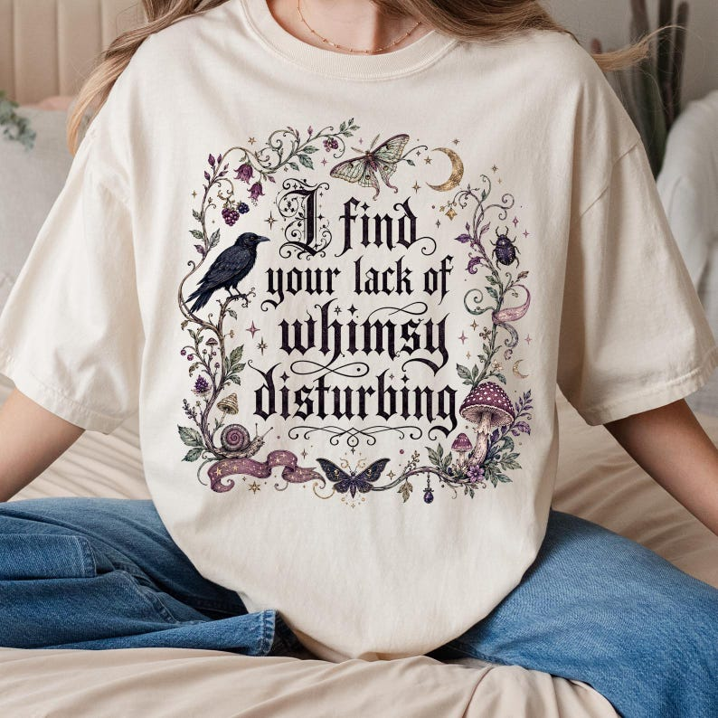

# DLS-ETSY-028 — Lack of Whimsy Crow Fall Shirt, Witchy Apparel, Autumn Shirt, Fall T-shirt, Halloween Shirt, Comfort Colors®, Mystical Shirt, Celestial Moth

Status: collected front-design reference; back unverified. No family synthesis.

- Product: https://www.etsy.com/listing/4554158839/lack-of-whimsy-crow-fall-shirt-witchy
- Seller: MindfulTops; Etsy. https://www.etsy.com/shop/MindfulTops
- Discovery: https://www.etsy.com/market/bestselling_tshirts; page 1, card position 60 (cumulative 60) (includes ads in numbering), Relevancy order, 2026-10-20. Sponsored cards skipped. Listing-level **Bestseller** button observed in live product page; evidence excerpt retained in batch JSON.
- Commercial signal: Etsy listing-level Bestseller badge. Not an audited sales count, global ranking, or proof that design caused demand. Mixed garment listings may aggregate tee/sweatshirt variants.
- Source image: https://i.etsystatic.com/62194007/r/il/10507b/8417919581/il_794xN.8417919581_mefk.jpg
- SHA-256: `d3ef24567e0e1e39a270fc20538ab87448375073537a61c115b7ef0c2a1b7750`. Original displayed CDN image, no editing; promotional mockup, not physical sample. Apparel variant chosen visually; decorative props and seller overlays are not part of print.
- Eligibility: complete predefined adult tee front; no observed licensed character or celebrity. Back unverified. Garment color/cut below are observations; fabric, print method and physical dimensions unverified unless explicitly attributed.
- Deduplication: not a recolor of another accepted listing in this route; cross-source reconciliation pending. Prior discovery IDs001–004 preserved separately and not silently recounted.

## Visual observation

Ivory roomy crew-neck on seated model. Large black ornate blackletter phrase stacked inside loose botanical/insect frame: crow left, moths, snail, mushrooms, crescent moon and tendrils. Muted purple/green/ochre accents around lettering; irregular organic perimeter rather than rectangle. Dense detailed central print with garment showing through gaps.

## Limits

Approximate mockup relationships only. No exact font identification, demographic assumption or recipe-family assignment. Listing keyword/title claims, stars, shop sales and Star Seller status do not substitute for the observed Bestseller badge.
