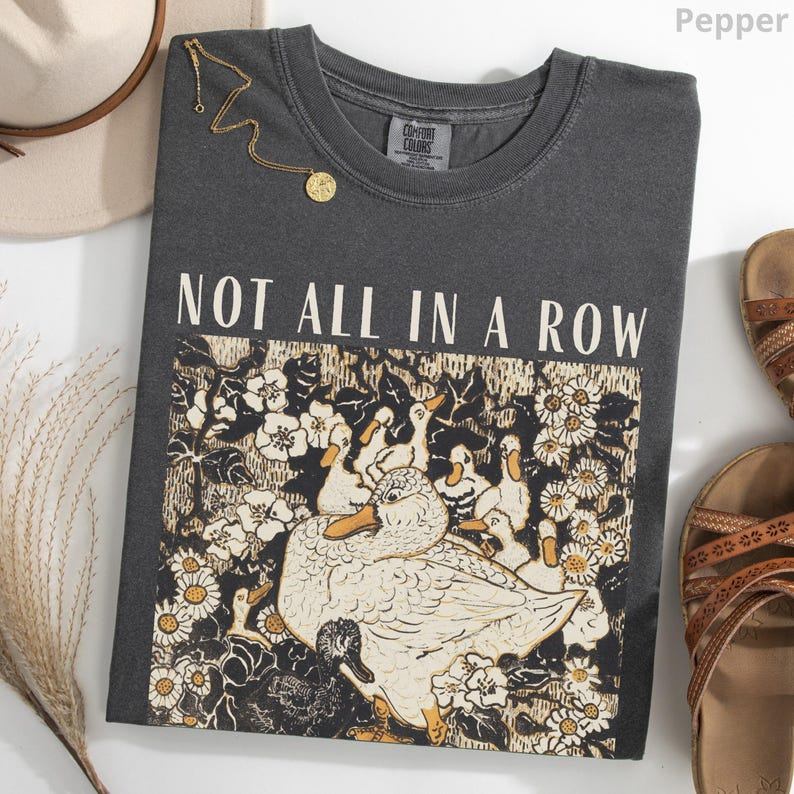

# DLS-ETSY-029 — Comfort Colors® Ducks Not in A Row Shirt, Funny Vintage Retro Animal Shirt, Homesteading Mama Duck Graphic Tee, Cottagecore Gift for Mom

Status: collected front-design reference; back unverified. No family synthesis.

- Product: https://www.etsy.com/listing/4327041745/comfort-colors-ducks-not-in-a-row-shirt
- Seller: ArtemOpus; Etsy. https://www.etsy.com/shop/ArtemOpus
- Discovery: https://www.etsy.com/market/bestselling_tshirts; page 2, card position 7 (cumulative 67) (includes ads in numbering), Relevancy order, 2026-10-20. Sponsored cards skipped. Listing-level **Bestseller** button observed in live product page; evidence excerpt retained in batch JSON.
- Commercial signal: Etsy listing-level Bestseller badge. Not an audited sales count, global ranking, or proof that design caused demand. Mixed garment listings may aggregate tee/sweatshirt variants.
- Source image: https://i.etsystatic.com/41282159/r/il/b1a62a/6974799096/il_794xN.6974799096_240t.jpg
- SHA-256: `1eb31193156874da1df87631574283e2a7e138a3f814e25c4181293007df2b96`. Original displayed CDN image, no editing; promotional mockup, not physical sample. Apparel variant chosen visually; decorative props and seller overlays are not part of print.
- Eligibility: complete predefined adult tee front; no observed licensed character or celebrity. Back unverified. Garment color/cut below are observations; fabric, print method and physical dimensions unverified unless explicitly attributed.
- Deduplication: not a recolor of another accepted listing in this route; cross-source reconciliation pending. Prior discovery IDs001–004 preserved separately and not silently recounted.

## Visual observation

Pepper charcoal folded crew-neck. Large cream/ochre woodcut-style rectangular scene packed with overlapping ducks, daisies and foliage; narrow uppercase caption above. Dense hatching and flat cream bird bodies contrasted by garment-dark negative shapes. Hard square boundary and illustration dominance deliberately retained as observed; broad chest coverage.

## Limits

Approximate mockup relationships only. No exact font identification, demographic assumption or recipe-family assignment. Listing keyword/title claims, stars, shop sales and Star Seller status do not substitute for the observed Bestseller badge.
