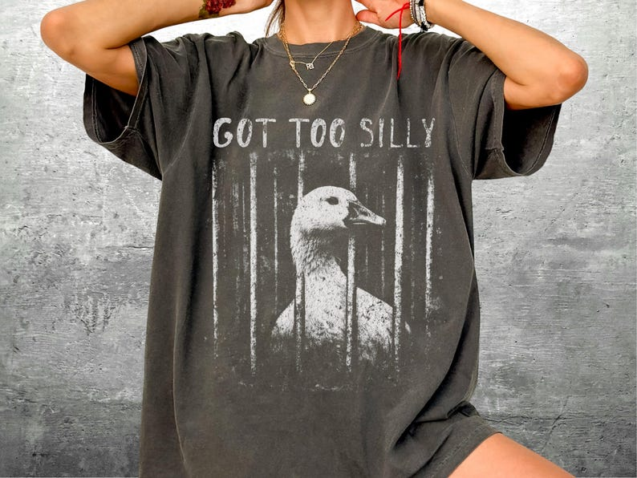

# DLS-ETSY-031 — Funny Silly Goose Meme Shirt, Got Too Silly, Oversize, Womens, Mens, Comfort Colors T-shirt

Status: collected front-design reference; back unverified. No family synthesis.

- Product: https://www.etsy.com/listing/4469170097/funny-silly-goose-meme-shirt-got-too
- Seller: KickAshCo; Etsy. https://www.etsy.com/shop/KickAshCo
- Discovery: https://www.etsy.com/market/bestselling_tshirts; page 2, card position 11 (cumulative 71) (includes ads in numbering), Relevancy order, 2026-10-20. Sponsored cards skipped. Listing-level **Bestseller** button observed in live product page; evidence excerpt retained in batch JSON.
- Commercial signal: Etsy listing-level Bestseller badge. Not an audited sales count, global ranking, or proof that design caused demand. Mixed garment listings may aggregate tee/sweatshirt variants.
- Source image: https://i.etsystatic.com/5768653/r/il/d2d87d/7786970896/il_794xN.7786970896_tg9b.jpg
- SHA-256: `792260b8c8b7e060475cb20703eabf352ebe115dee51a16cdc56a90deffc9fae`. Original displayed CDN image, no editing; promotional mockup, not physical sample. Apparel variant chosen visually; decorative props and seller overlays are not part of print.
- Eligibility: complete predefined adult tee front; no observed licensed character or celebrity. Back unverified. Garment color/cut below are observations; fabric, print method and physical dimensions unverified unless explicitly attributed.
- Deduplication: not a recolor of another accepted listing in this route; cross-source reconciliation pending. Prior discovery IDs001–004 preserved separately and not silently recounted.

## Visual observation

Washed dark charcoal oversized-looking crew-neck on model. Large pale distressed rectangular image of goose behind vertical prison bars; narrow uppercase GOT TOO SILLY above. Strong scratching/grunge fade reduces hard lower border; monochrome pale print against dark garment. Illustration dominates chest height.

## Limits

Approximate mockup relationships only. No exact font identification, demographic assumption or recipe-family assignment. Listing keyword/title claims, stars, shop sales and Star Seller status do not substitute for the observed Bestseller badge.
