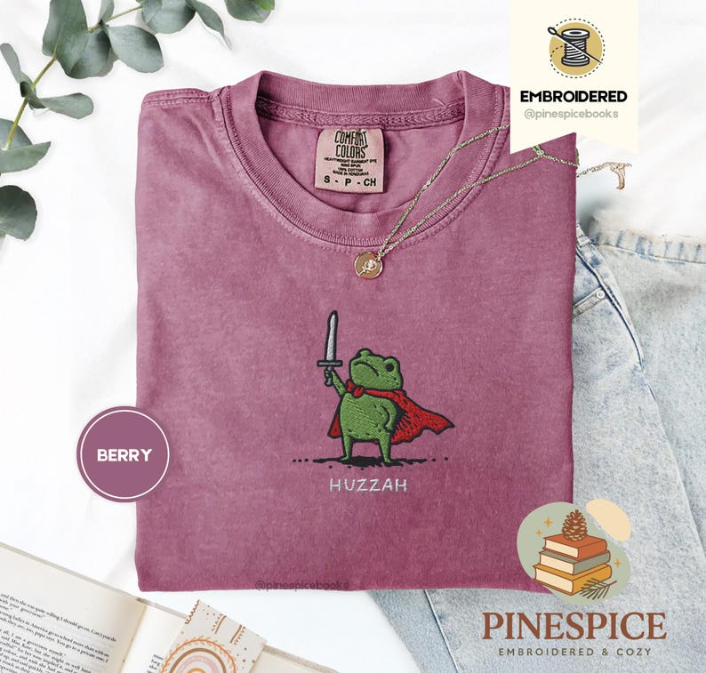

# DLS-ETSY-033 — Huzzah Frog with Sword Tee, Embroidered Medieval Frog Shirt, Comfort Colors 1717, Funny DnD T-Shirt, Renaissance Faire Frog Gift

Status: collected front-design reference; back unverified. No family synthesis.

- Product: https://www.etsy.com/listing/4350974897/huzzah-frog-with-sword-tee-embroidered
- Seller: PineSpiceBooks; Etsy. https://www.etsy.com/shop/PineSpiceBooks
- Discovery: https://www.etsy.com/market/bestselling_tshirts; page 2, card position 18 (cumulative 78) (includes ads in numbering), Relevancy order, 2026-10-20. Sponsored cards skipped. Listing-level **Bestseller** button observed in live product page; evidence excerpt retained in batch JSON.
- Commercial signal: Etsy listing-level Bestseller badge. Not an audited sales count, global ranking, or proof that design caused demand. Mixed garment listings may aggregate tee/sweatshirt variants.
- Source image: https://i.etsystatic.com/47460975/r/il/489fc1/7105767930/il_794xN.7105767930_fc4k.jpg
- SHA-256: `5e97862d7ad8139bacccd84429199ce46a8d827ab515cc2a4cbe7f5e236ee17b`. Original displayed CDN image, no editing; promotional mockup, not physical sample. Apparel variant chosen visually; decorative props and seller overlays are not part of print.
- Eligibility: complete predefined adult tee front; no observed licensed character or celebrity. Back unverified. Garment color/cut below are observations; fabric, print method and physical dimensions unverified unless explicitly attributed.
- Deduplication: not a recolor of another accepted listing in this route; cross-source reconciliation pending. Prior discovery IDs001–004 preserved separately and not silently recounted.

## Visual observation

Berry/mauve folded crew-neck with small centered green frog in red cape raising sword, tiny pale HUZAAH-like caption below (listing title Huzzah). Seller marks it EMBROIDERED; visible compact outlined motif with large surrounding plain fabric. Stitch construction claimed by seller, not independently sampled. Recreating in DTG would require deliberate adaptation of edge/texture; not assumed equivalent.

## Limits

Approximate mockup relationships only. No exact font identification, demographic assumption or recipe-family assignment. Listing keyword/title claims, stars, shop sales and Star Seller status do not substitute for the observed Bestseller badge.
