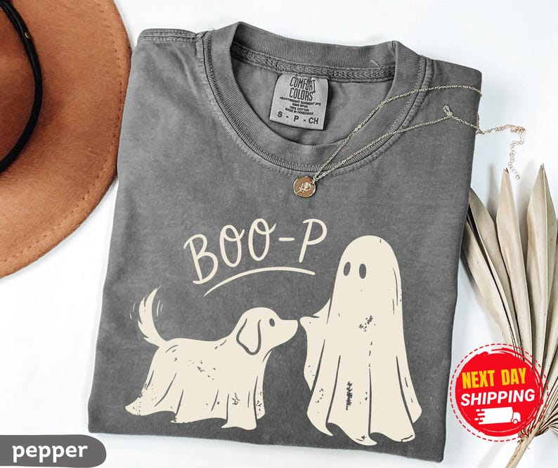

# DLS-ETSY-034 — Boo-p Ghost Dog Comfort Colors T-Shirt, Funny Halloween Dog Mom Shirt

Status: collected front-design reference; back unverified. No family synthesis.

- Product: https://www.etsy.com/listing/4560244580/boo-p-ghost-dog-comfort-colors-t-shirt
- Seller: NewTeeApparel; Etsy. https://www.etsy.com/shop/NewTeeApparel
- Discovery: https://www.etsy.com/market/bestselling_tshirts; page 2, card position 21 (cumulative 81) (includes ads in numbering), Relevancy order, 2026-10-20. Sponsored cards skipped. Listing-level **Bestseller** button observed in live product page; evidence excerpt retained in batch JSON.
- Commercial signal: Etsy listing-level Bestseller badge. Not an audited sales count, global ranking, or proof that design caused demand. Mixed garment listings may aggregate tee/sweatshirt variants.
- Source image: https://i.etsystatic.com/47938130/r/il/f46a8b/8462022463/il_794xN.8462022463_onb3.jpg
- SHA-256: `edb64d4e857bd51c1aba88be95effdc7d27e88690d3c6cb26ae0740df753f33f`. Original displayed CDN image, no editing; promotional mockup, not physical sample. Apparel variant chosen visually; decorative props and seller overlays are not part of print.
- Eligibility: complete predefined adult tee front; no observed licensed character or celebrity. Back unverified. Garment color/cut below are observations; fabric, print method and physical dimensions unverified unless explicitly attributed.
- Deduplication: not a recolor of another accepted listing in this route; cross-source reconciliation pending. Prior discovery IDs001–004 preserved separately and not silently recounted.

## Visual observation

Pepper-gray folded crew-neck. Large simple cream dog and sheet ghost nose-to-nose, arched loose handwritten BOO-P above with underline. Single-color silhouettes use garment-gray cutouts for facial/body details; small irregular marks add weathering. Medium-wide open composition without enclosure; shipping/color overlays are not print.

## Limits

Approximate mockup relationships only. No exact font identification, demographic assumption or recipe-family assignment. Listing keyword/title claims, stars, shop sales and Star Seller status do not substitute for the observed Bestseller badge.
