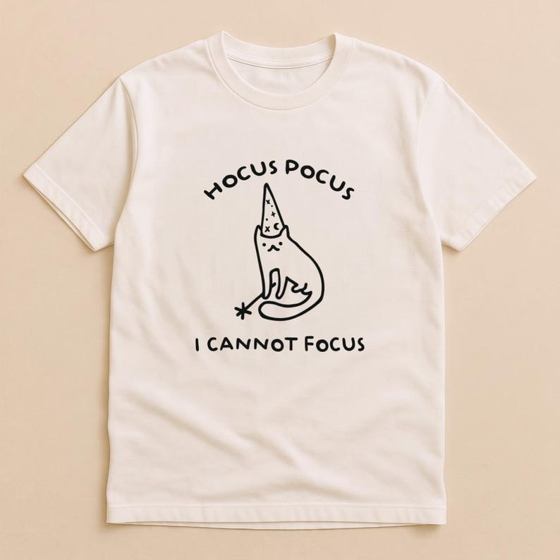

# DLS-ETSY-037 — Hocus Pocus I Cannot Focus T-Shirt • Funny Cat Wizard Design • Sarcastic Graphic Shirt • ADHD Humor Gift • Unisex S-XXL

Status: collected front-design reference; back unverified. No family synthesis.

- Product: https://www.etsy.com/listing/4538151424/hocus-pocus-i-cannot-focus-t-shirt-funny
- Seller: SeoulyWear; Etsy. https://www.etsy.com/shop/SeoulyWear
- Discovery: https://www.etsy.com/market/bestselling_tshirts; page 2, card position 32 (cumulative 92) (includes ads in numbering), Relevancy order, 2026-10-20. Sponsored cards skipped. Listing-level **Bestseller** button observed in live product page; evidence excerpt retained in batch JSON.
- Commercial signal: Etsy listing-level Bestseller badge. Not an audited sales count, global ranking, or proof that design caused demand. Mixed garment listings may aggregate tee/sweatshirt variants.
- Source image: https://i.etsystatic.com/61483876/r/il/5d40ad/8254137124/il_794xN.8254137124_kfve.jpg
- SHA-256: `b672436632f957f9b6800f718e6b5ba12cfefb6db28aaf7975c41c619dbe304f`. Original displayed CDN image, no editing; promotional mockup, not physical sample. Apparel variant chosen visually; decorative props and seller overlays are not part of print.
- Eligibility: complete predefined adult tee front; no observed licensed character or celebrity. Back unverified. Garment color/cut below are observations; fabric, print method and physical dimensions unverified unless explicitly attributed.
- Deduplication: not a recolor of another accepted listing in this route; cross-source reconciliation pending. Prior discovery IDs001–004 preserved separately and not silently recounted.

## Visual observation

Cream crew-neck flat laid. Medium-small simple black outline cat in tall wizard hat, wand/star detail; rounded uppercase setup arcs above and ending curves gently below. Sparse playful line drawing, no color accents or hard border; ample garment margin. Generic wizard cat rather than named film character.

## Limits

Approximate mockup relationships only. No exact font identification, demographic assumption or recipe-family assignment. Listing keyword/title claims, stars, shop sales and Star Seller status do not substitute for the observed Bestseller badge.
