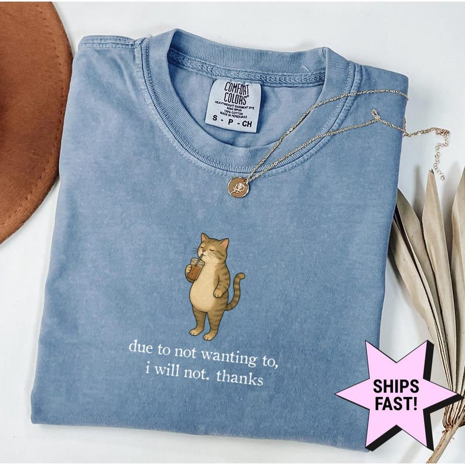

# DLS-ETSY-039 — Comfort Colors® Due To Not Wanting To I Will Not Thanks Shirt, Funny Cat Graphic Tee, Sarcastic Quote Shirt, Funny Cat Lover Gift

Status: collected front-design reference; back unverified. No family synthesis.

- Product: https://www.etsy.com/listing/4557164075/comfort-colors-due-to-not-wanting-to-i
- Seller: njdApparel; Etsy. https://www.etsy.com/shop/njdApparel
- Discovery: https://www.etsy.com/market/bestselling_tshirts; page 2, card position 43 (cumulative 103) (includes ads in numbering), Relevancy order, 2026-10-20. Sponsored cards skipped. Listing-level **Bestseller** button observed in live product page; evidence excerpt retained in batch JSON.
- Commercial signal: Etsy listing-level Bestseller badge. Not an audited sales count, global ranking, or proof that design caused demand. Mixed garment listings may aggregate tee/sweatshirt variants.
- Source image: https://i.etsystatic.com/28590603/r/il/2bf383/8440031853/il_794xN.8440031853_h4tp.jpg
- SHA-256: `4b1670780e8e47d385ee82d1dc34cf53697b87d39e1cb4f2ef7fc851692e0160`. Original displayed CDN image, no editing; promotional mockup, not physical sample. Apparel variant chosen visually; decorative props and seller overlays are not part of print.
- Eligibility: complete predefined adult tee front; no observed licensed character or celebrity. Back unverified. Garment color/cut below are observations; fabric, print method and physical dimensions unverified unless explicitly attributed.
- Deduplication: not a recolor of another accepted listing in this route; cross-source reconciliation pending. Prior discovery IDs001–004 preserved separately and not silently recounted.

## Visual observation

Dusty blue folded crew-neck. Small upright orange tabby cat with one paw at face above tiny pale two-line serif refusal phrase. Compact isolated illustration/copy unit centered chest, large blank garment area; print colors subdued against blue. Shipping badge and jewelry outside art excluded.

## Limits

Approximate mockup relationships only. No exact font identification, demographic assumption or recipe-family assignment. Listing keyword/title claims, stars, shop sales and Star Seller status do not substitute for the observed Bestseller badge.
