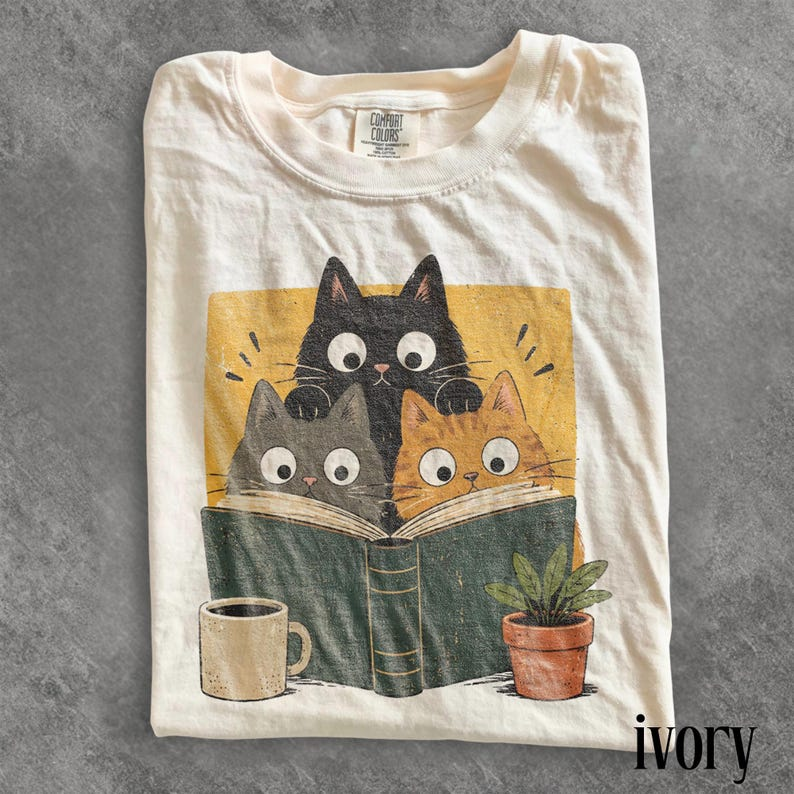

# DLS-ETSY-044 — Retro Curious Reading Cats Graphic Tee, Book Lover Cat Shirt, Cozy Cottagecore Vintage Top, Comfort Colors® Reader Gift Tee

Status: collected front-design reference; back unverified. No family synthesis.

- Product: https://www.etsy.com/listing/4535598479/retro-curious-reading-cats-graphic-tee
- Seller: ThreadPeakShop; Etsy. https://www.etsy.com/shop/ThreadPeakShop
- Discovery: https://www.etsy.com/market/bestselling_tshirts; page 3, card position 7 (cumulative 127) (includes ads in numbering), Relevancy order, 2026-10-20. Sponsored cards skipped. Listing-level **Bestseller** button observed in live product page; evidence excerpt retained in batch JSON.
- Commercial signal: Etsy listing-level Bestseller badge. Not an audited sales count, global ranking, or proof that design caused demand. Mixed garment listings may aggregate tee/sweatshirt variants.
- Source image: https://i.etsystatic.com/65487660/r/il/35778d/8235157396/il_794xN.8235157396_r18i.jpg
- SHA-256: `0fa94865249dbc0969edbe370731768dd8dcf04e32a3aae6af00dff415b42bb6`. Original displayed CDN image, no editing; promotional mockup, not physical sample. Apparel variant chosen visually; decorative props and seller overlays are not part of print.
- Eligibility: complete predefined adult tee front; no observed licensed character or celebrity. Back unverified. Garment color/cut below are observations; fabric, print method and physical dimensions unverified unless explicitly attributed.
- Deduplication: not a recolor of another accepted listing in this route; cross-source reconciliation pending. Prior discovery IDs001–004 preserved separately and not silently recounted.

## Visual observation

Ivory folded crew-neck. Large playful illustration of three wide-eyed cats peering over oversized dark green open book; mustard rectangular background behind cats, coffee cup and plant overlap lower edge. Black/gray/orange cats and muted earth colors, worn grain texture, no copy. Layered objects break rectangular frame at base; image fills broad chest.

## Limits

Approximate mockup relationships only. No exact font identification, demographic assumption or recipe-family assignment. Listing keyword/title claims, stars, shop sales and Star Seller status do not substitute for the observed Bestseller badge.
