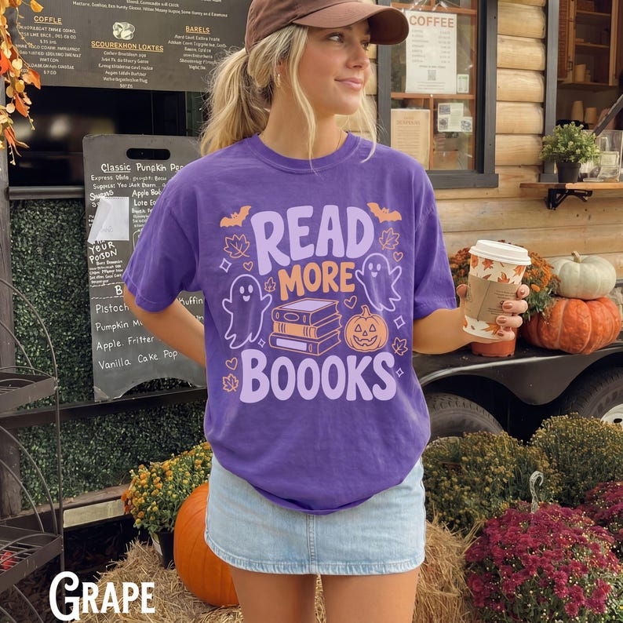

# DLS-ETSY-046 — Halloween Bookish Shirt, Comfort Colors, Teacher Tee, Read More Books, Book Lover Tshirt, Reading, Literature, Language Arts, ELA, Librairan

Status: collected front-design reference; back unverified. No family synthesis.

- Product: https://www.etsy.com/listing/4539164518/halloween-bookish-shirt-comfort-colors
- Seller: FunDesignTrends; Etsy. https://www.etsy.com/shop/FunDesignTrends
- Discovery: https://www.etsy.com/market/bestselling_tshirts; page 3, card position 12 (cumulative 132) (includes ads in numbering), Relevancy order, 2026-10-20. Sponsored cards skipped. Listing-level **Bestseller** button observed in live product page; evidence excerpt retained in batch JSON.
- Commercial signal: Etsy listing-level Bestseller badge. Not an audited sales count, global ranking, or proof that design caused demand. Mixed garment listings may aggregate tee/sweatshirt variants.
- Source image: https://i.etsystatic.com/20851833/r/il/394ed7/8315822591/il_794xN.8315822591_d7fm.jpg
- SHA-256: `6d2d6112395349837dc5897c42c0eca48b9761efef11343ebf2816a04057086b`. Original displayed CDN image, no editing; promotional mockup, not physical sample. Apparel variant chosen visually; decorative props and seller overlays are not part of print.
- Eligibility: complete predefined adult tee front; no observed licensed character or celebrity. Back unverified. Garment color/cut below are observations; fabric, print method and physical dimensions unverified unless explicitly attributed.
- Deduplication: not a recolor of another accepted listing in this route; cross-source reconciliation pending. Prior discovery IDs001–004 preserved separately and not silently recounted.

## Visual observation

Saturated purple roomy crew-neck on model. Large rounded pale-lavender READ and BOOOKS frame smaller ochre MORE, book stack, outlined ghosts, pumpkin and bats. Tall centered mixed type/image block, outlines lighten illustration density. Purple garment participates as interior ghost/book negative space; large text dominates reading distance.

## Limits

Approximate mockup relationships only. No exact font identification, demographic assumption or recipe-family assignment. Listing keyword/title claims, stars, shop sales and Star Seller status do not substitute for the observed Bestseller badge.
