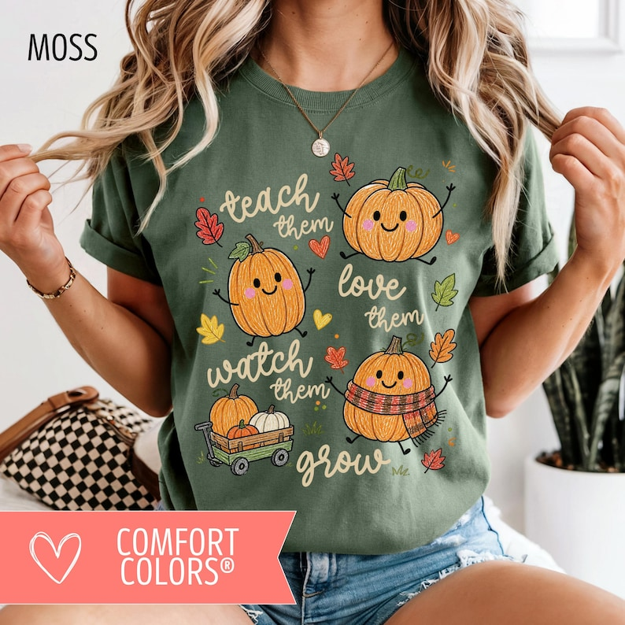

# DLS-ETSY-048 — Fall Teacher Shirt: Comfort Colors Teach Them Tee, Teaching Pumpkins Thanksgiving Tee, Autumn Pumpkin Teacher Gift, Daycare PreK Teacher

Status: collected front-design reference; back unverified. No family synthesis.

- Product: https://www.etsy.com/listing/4553956191/fall-teacher-shirt-comfort-colors-teach
- Seller: HopsAndHospitality; Etsy. https://www.etsy.com/shop/HopsAndHospitality
- Discovery: https://www.etsy.com/market/bestselling_tshirts; page 3, card position 20 (cumulative 140) (includes ads in numbering), Relevancy order, 2026-10-20. Sponsored cards skipped. Listing-level **Bestseller** button observed in live product page; evidence excerpt retained in batch JSON.
- Commercial signal: Etsy listing-level Bestseller badge. Not an audited sales count, global ranking, or proof that design caused demand. Mixed garment listings may aggregate tee/sweatshirt variants.
- Source image: https://i.etsystatic.com/22361271/r/il/b257ee/8378801582/il_794xN.8378801582_d75a.jpg
- SHA-256: `bb02a0545b0572752e0cd338ea3083dccb3dd24035e217bb7675ee1a34cf22a1`. Original displayed CDN image, no editing; promotional mockup, not physical sample. Apparel variant chosen visually; decorative props and seller overlays are not part of print.
- Eligibility: complete predefined adult tee front; no observed licensed character or celebrity. Back unverified. Garment color/cut below are observations; fabric, print method and physical dimensions unverified unless explicitly attributed.
- Deduplication: not a recolor of another accepted listing in this route; cross-source reconciliation pending. Prior discovery IDs001–004 preserved separately and not silently recounted.

## Visual observation

Moss-green crew-neck on model. Tall pale hand-lettered teaching phrase interleaved with three orange smiling pumpkins, books and scattered autumn leaves/hearts. Warm orange, pale yellow and muted red accents contrast green; diagonal alternation of words and pumpkins creates informal rhythm. Print spans most chest; seller brand ribbon outside artwork.

## Limits

Approximate mockup relationships only. No exact font identification, demographic assumption or recipe-family assignment. Listing keyword/title claims, stars, shop sales and Star Seller status do not substitute for the observed Bestseller badge.
