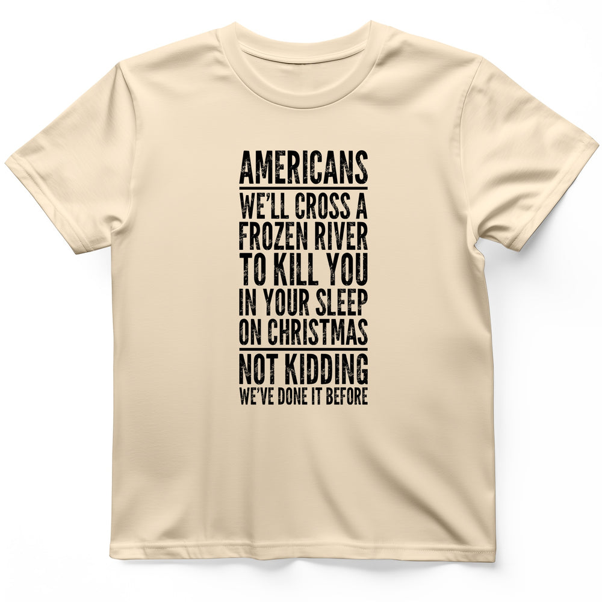

# DLS-HISTOREE-005 — Cross A River On Xmas T-Shirt

Status: collected front-design reference; back placement unverified. No recipe classification.

- Product: https://historeetees.com/products/cross-a-river-on-xmas-t-shirt
- Seller: HistoreeTees; individual designer unknown.
- Route: https://historeetees.com/collections/recent-best-sellers — default order, observed 2026-10-20, position 1, displayed page 1. Compact feed roster retained; displayed first-page order checked.
- Commercial signal: seller-designated Current Best Sellers collection membership, not audited sales or sales rank.
- Source image: https://cdn.shopify.com/s/files/1/0625/2599/7280/files/Natural_Cross_A_River_On_Xmas_T-Shirt_c788276c-9f64-490e-af54-ae3d26973983.jpg?v=1788559302
- Retained SHA-256: `ab5568e42708ee3ceea7998f1e9dc5b9c41eb51fdccdac4e0921f8b00fe1f6fa`. Unaltered seller CDN rendition, requested width 1000.
- Eligibility: adult physical tee; complete predefined design. Historical people/events are treated as historical subject matter, consistent with the approved HistoreeTees study; not a claim of clearance for reproducing the portraits/artwork. No identified entertainment celebrity or licensed fictional character dependency.
- Placement: visible front graphic; no back-print evidence in product image metadata or description. No affirmative blank-back evidence established, so back remains unverified. Production suitability is separate.
- Seller-listed garment: Gildan 64000 Softstyle unisex preshrunk tee. Solid colors cotton; Sport Grey 90% cotton/10% polyester; Heather Navy 35% cotton/65% polyester. Weight and actual print dimensions unverified.
- Deduplication: new expanded record; recolors count once. No duplicate artwork found within this source batch; global reconciliation pending.

## Visual observation

A narrow tall column of distressed black condensed capitals occupies the central chest of a natural cream tee. Line widths are tightly aligned; horizontal rules separate opening identity and closing emphasis. Several large phrases alternate with smaller linking lines. No image, border or background panel. Texture roughens the otherwise rigid block. Long copy and narrow width require sustained reading; the cream cloth supplies all internal negative space.

## Limits

Apparent proportions are qualitative estimates from a mockup. Subject affinity and prior historical knowledge can contribute to appeal. No causal claim about the design, audience demographics, or recipe transfer is made.
