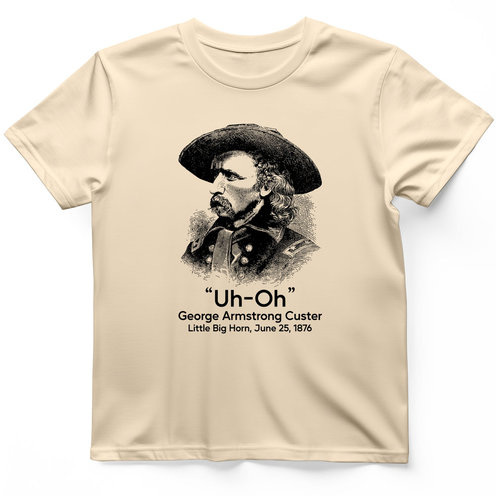

# DLS-HISTOREE-006 — Custer Uh-Oh T-Shirt

Status: collected front-design reference; back placement unverified. No recipe classification.

- Product: https://historeetees.com/products/custer-uh-oh-t-shirt
- Seller: HistoreeTees; individual designer unknown.
- Route: https://historeetees.com/collections/recent-best-sellers — default order, observed 2026-10-20, position 2, displayed page 1. Compact feed roster retained; displayed first-page order checked.
- Commercial signal: seller-designated Current Best Sellers collection membership, not audited sales or sales rank.
- Source image: https://cdn.shopify.com/s/files/1/0625/2599/7280/files/Natural_Custer_Uh-Oh_T-Shirt_06802f35-7787-4576-abc8-332a7b3fa857.jpg?v=1788725009
- Retained SHA-256: `4468de3c1e07a331b2fe1b65c8bff430a4f92c98cc9acf9a7c21178140acc01b`. Unaltered seller CDN rendition, requested width 1000.
- Eligibility: adult physical tee; complete predefined design. Historical people/events are treated as historical subject matter, consistent with the approved HistoreeTees study; not a claim of clearance for reproducing the portraits/artwork. No identified entertainment celebrity or licensed fictional character dependency.
- Placement: visible front graphic; no back-print evidence in product image metadata or description. No affirmative blank-back evidence established, so back remains unverified. Production suitability is separate.
- Seller-listed garment: Gildan 64000 Softstyle unisex preshrunk tee. Solid colors cotton; Sport Grey 90% cotton/10% polyester; Heather Navy 35% cotton/65% polyester. Weight and actual print dimensions unverified.
- Deduplication: new expanded record; recolors count once. No duplicate artwork found within this source batch; global reconciliation pending.

## Visual observation

A large monochrome engraved historical bust sits above a short sans-serif quotation, then two smaller identification/date lines. The hat and shoulders make an irregular silhouette rather than a rectangle. Black fine hatch lines on natural cream suggest an archival print; the quotation is much simpler than the image. Center-front portrait-led composition, with detail and historical recognition carrying much of the meaning.

## Limits

Apparent proportions are qualitative estimates from a mockup. Subject affinity and prior historical knowledge can contribute to appeal. No causal claim about the design, audience demographics, or recipe transfer is made.
