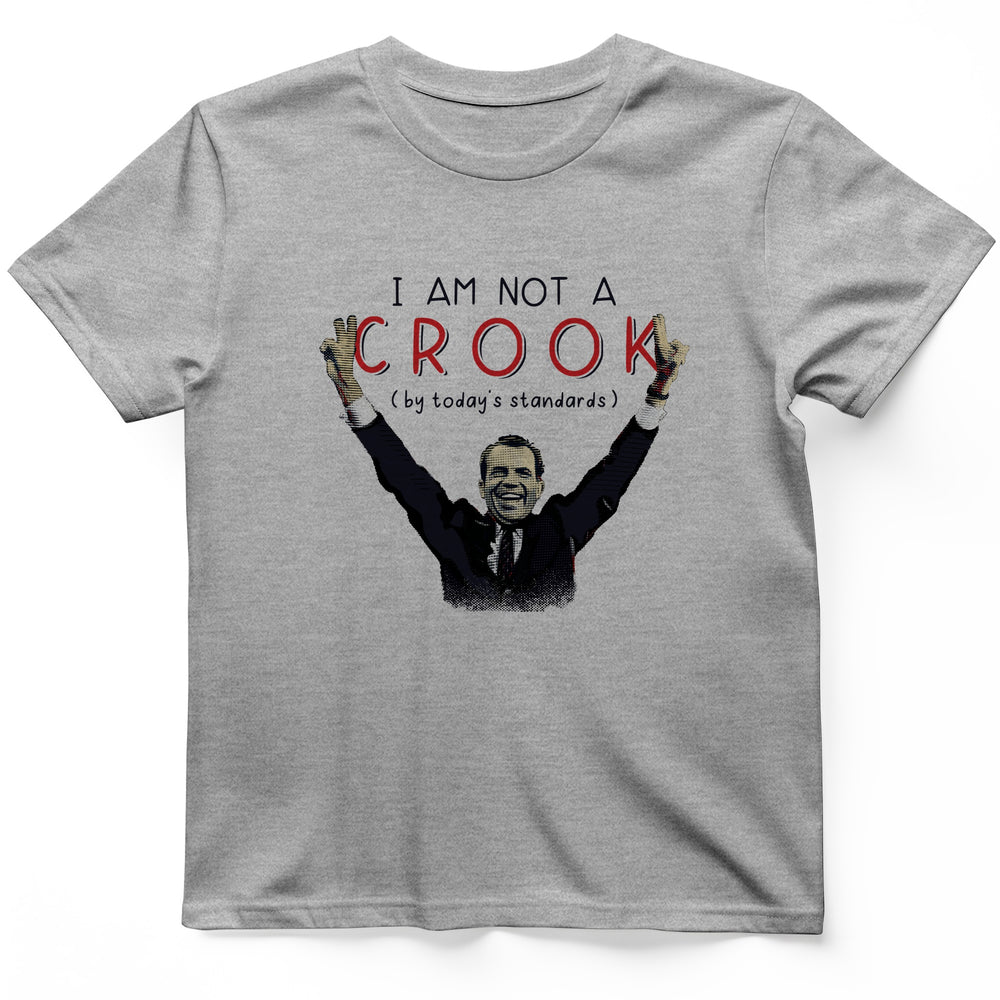

# DLS-HISTOREE-009 — Not a Crook T-Shirt

Status: collected front-design reference; back placement unverified. No recipe classification.

- Product: https://historeetees.com/products/not-a-crook-t-shirt
- Seller: HistoreeTees; individual designer unknown.
- Route: https://historeetees.com/collections/recent-best-sellers — default order, observed 2026-10-20, position 5, displayed page 1. Compact feed roster retained; displayed first-page order checked.
- Commercial signal: seller-designated Current Best Sellers collection membership, not audited sales or sales rank.
- Source image: https://cdn.shopify.com/s/files/1/0625/2599/7280/files/SportsGrey_Not_a_Crook_T-Shirt_830f745a-3331-4355-b196-881c508b14f0.jpg?v=1788626019
- Retained SHA-256: `2bcd99c58f7d6cbe2c8dcfc7d1226d35a71affcabf1bf0cdb2a7e10169103952`. Unaltered seller CDN rendition, requested width 1000.
- Eligibility: adult physical tee; complete predefined design. Historical people/events are treated as historical subject matter, consistent with the approved HistoreeTees study; not a claim of clearance for reproducing the portraits/artwork. No identified entertainment celebrity or licensed fictional character dependency.
- Placement: visible front graphic; no back-print evidence in product image metadata or description. No affirmative blank-back evidence established, so back remains unverified. Production suitability is separate.
- Seller-listed garment: Gildan 64000 Softstyle unisex preshrunk tee. Solid colors cotton; Sport Grey 90% cotton/10% polyester; Heather Navy 35% cotton/65% polyester. Weight and actual print dimensions unverified.
- Deduplication: new expanded record; recolors count once. No duplicate artwork found within this source batch; global reconciliation pending.

## Visual observation

A halftone-like historical figure with raised arms sits beneath widely tracked thin black capitals and an oversized red outlined key word. Raised hands flank that word; a small parenthetical line fits between arms above the head. Broad medium-tall chest graphic on gray heather. Black clothing merges with shadow while tan facial highlights add warmth. Figure and words are spatially interlocked; small qualifiers and portrait detail can be lost at distance.

## Limits

Apparent proportions are qualitative estimates from a mockup. Subject affinity and prior historical knowledge can contribute to appeal. No causal claim about the design, audience demographics, or recipe transfer is made.
