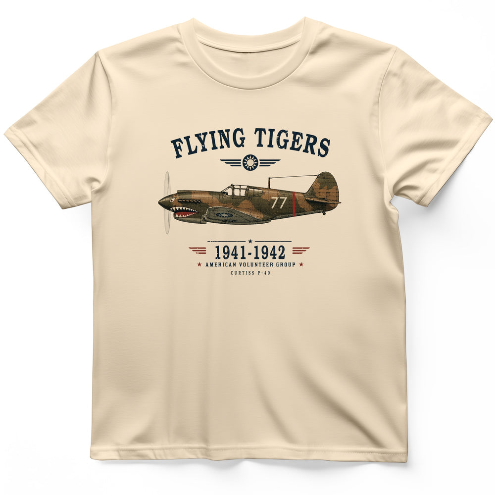

# DLS-HISTOREE-011 — Flying Tigers T-Shirt

Status: collected front-design reference; back placement unverified. No recipe classification.

- Product: https://historeetees.com/products/flying-tigers-t-shirt
- Seller: HistoreeTees; individual designer unknown.
- Route: https://historeetees.com/collections/recent-best-sellers — default order, observed 2026-10-20, position 7, displayed page 1. Compact feed roster retained; displayed first-page order checked.
- Commercial signal: seller-designated Current Best Sellers collection membership, not audited sales or sales rank.
- Source image: https://cdn.shopify.com/s/files/1/0625/2599/7280/files/Natural_Flying_Tigers_T-Shirt.jpg?v=1792438017
- Retained SHA-256: `d44192ce534d50bda0d3d493ca40022b5eb87a2f900c9ae5dc5f1cb3d24e703a`. Unaltered seller CDN rendition, requested width 1000.
- Eligibility: adult physical tee; complete predefined design. Historical people/events are treated as historical subject matter, consistent with the approved HistoreeTees study; not a claim of clearance for reproducing the portraits/artwork. No identified entertainment celebrity or licensed fictional character dependency.
- Placement: visible front graphic; no back-print evidence in product image metadata or description. No affirmative blank-back evidence established, so back remains unverified. Production suitability is separate.
- Seller-listed garment: Gildan 64000 Softstyle unisex preshrunk tee. Solid colors cotton; Sport Grey 90% cotton/10% polyester; Heather Navy 35% cotton/65% polyester. Weight and actual print dimensions unverified.
- Deduplication: new expanded record; recolors count once. No duplicate artwork found within this source batch; global reconciliation pending.

## Visual observation

Dark navy arched slab-serif title caps a small wing emblem and a detailed side-view olive/brown aircraft on natural cream. A condensed date range, red/navy stars and tiny service labels form a narrower lower anchor. The plane stretches nearly the full graphic width. Distressed textures soften the illustration and type. Broad medium chest print with open gaps; tiny technical labels and aircraft detail reward close viewing.

## Limits

Apparent proportions are qualitative estimates from a mockup. Subject affinity and prior historical knowledge can contribute to appeal. No causal claim about the design, audience demographics, or recipe transfer is made.
