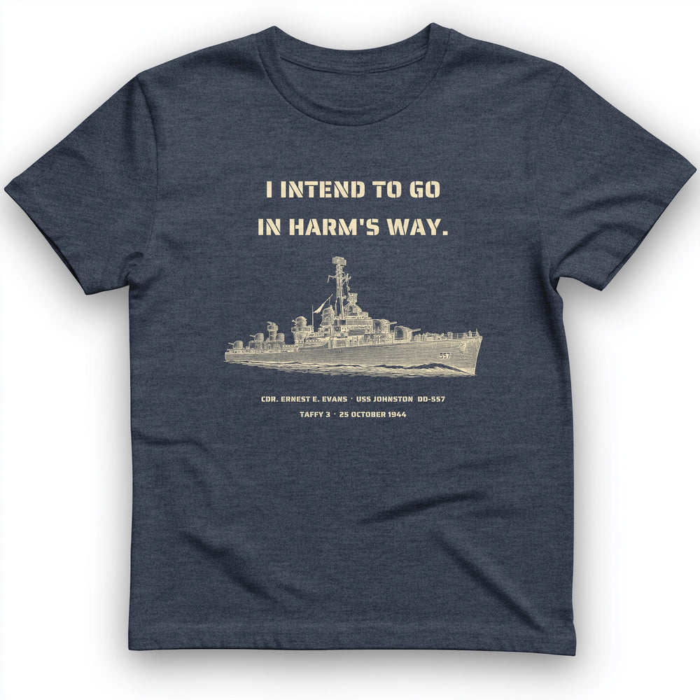

# DLS-HISTOREE-012 — USS Johnston In Harm's Way T-Shirt

Status: collected front-design reference; back placement unverified. No recipe classification.

- Product: https://historeetees.com/products/uss-johnston-in-harms-way-t-shirt
- Seller: HistoreeTees; individual designer unknown.
- Route: https://historeetees.com/collections/recent-best-sellers — default order, observed 2026-10-20, position 8, displayed page 1. Compact feed roster retained; displayed first-page order checked.
- Commercial signal: seller-designated Current Best Sellers collection membership, not audited sales or sales rank.
- Source image: https://cdn.shopify.com/s/files/1/0625/2599/7280/files/H.Navy_USS_Johnston_In_Harms_Way_T-Shirt.jpg?v=1792449097
- Retained SHA-256: `e9400c88c8618f1c94a72404738ad9a2e6f33e1ae920fccdb7e8e82001ab1e9a`. Unaltered seller CDN rendition, requested width 1000.
- Eligibility: adult physical tee; complete predefined design. Historical people/events are treated as historical subject matter, consistent with the approved HistoreeTees study; not a claim of clearance for reproducing the portraits/artwork. No identified entertainment celebrity or licensed fictional character dependency.
- Placement: visible front graphic; no back-print evidence in product image metadata or description. No affirmative blank-back evidence established, so back remains unverified. Production suitability is separate.
- Seller-listed garment: Gildan 64000 Softstyle unisex preshrunk tee. Solid colors cotton; Sport Grey 90% cotton/10% polyester; Heather Navy 35% cotton/65% polyester. Weight and actual print dimensions unverified.
- Deduplication: new expanded record; recolors count once. No duplicate artwork found within this source batch; global reconciliation pending.

## Visual observation

Two cream stencil-capital lines sit well above a finely drawn cream ship profile on heather navy. Two tiny identification/date lines sit below the vessel. The ship is much wider than the headline, with mast creating a central vertical connection. Medium-large center-front open composition, single light color appearance. Low-density fine-line detail may be obscured by heather texture or small print scale.

## Limits

Apparent proportions are qualitative estimates from a mockup. Subject affinity and prior historical knowledge can contribute to appeal. No causal claim about the design, audience demographics, or recipe transfer is made.
