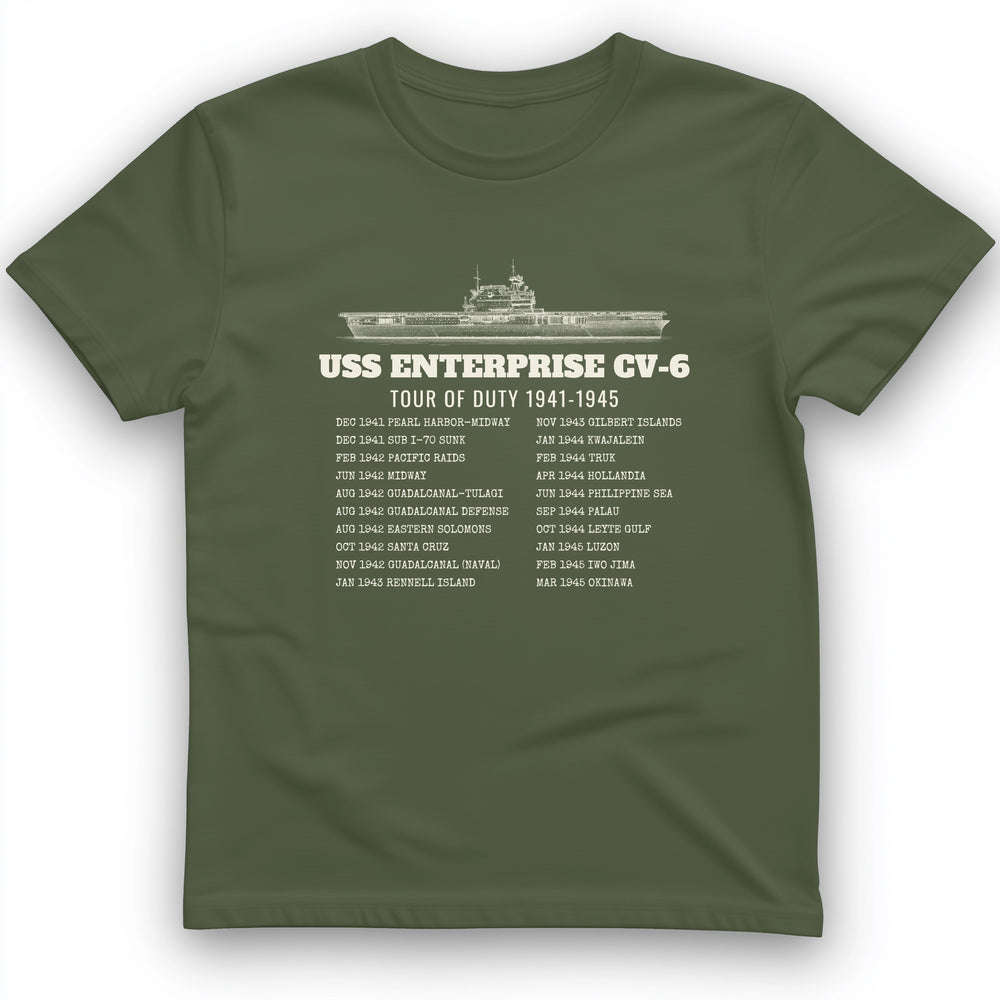

# DLS-HISTOREE-014 — Enterprise Tour Of Duty T-Shirt

Status: collected front-design reference; back placement unverified. No recipe classification.

- Product: https://historeetees.com/products/enterprise-tour-of-duty-t-shirt
- Seller: HistoreeTees; individual designer unknown.
- Route: https://historeetees.com/collections/recent-best-sellers — default order, observed 2026-10-20, position 10, displayed page 1. Compact feed roster retained; displayed first-page order checked.
- Commercial signal: seller-designated Current Best Sellers collection membership, not audited sales or sales rank.
- Source image: https://cdn.shopify.com/s/files/1/0625/2599/7280/files/MilitaryGreen_Enterprise_Tour_Of_Duty_T-Shirt.jpg?v=1792438158
- Retained SHA-256: `82805e890c83c8a11694bc19248fd7336b4cc8a8c03fd2c6608e8974142f191a`. Unaltered seller CDN rendition, requested width 1000.
- Eligibility: adult physical tee; complete predefined design. Historical people/events are treated as historical subject matter, consistent with the approved HistoreeTees study; not a claim of clearance for reproducing the portraits/artwork. No identified entertainment celebrity or licensed fictional character dependency.
- Placement: visible front graphic; no back-print evidence in product image metadata or description. No affirmative blank-back evidence established, so back remains unverified. Production suitability is separate.
- Seller-listed garment: Gildan 64000 Softstyle unisex preshrunk tee. Solid colors cotton; Sport Grey 90% cotton/10% polyester; Heather Navy 35% cotton/65% polyester. Weight and actual print dimensions unverified.
- Deduplication: new expanded record; recolors count once. No duplicate artwork found within this source batch; global reconciliation pending.

## Visual observation

A thin cream aircraft-carrier profile sits above a bold slab-capital title and narrow condensed subtitle. Two evenly aligned columns of small serif dates/events fill the lower half. Compact centered documentary block on olive, single light color appearance. The horizontal vessel and strong title establish identity; dense list copy requires close viewing. It resembles tour merchandise through the dates and columns, but that is an individual observation, not a recipe grouping.

## Limits

Apparent proportions are qualitative estimates from a mockup. Subject affinity and prior historical knowledge can contribute to appeal. No causal claim about the design, audience demographics, or recipe transfer is made.
