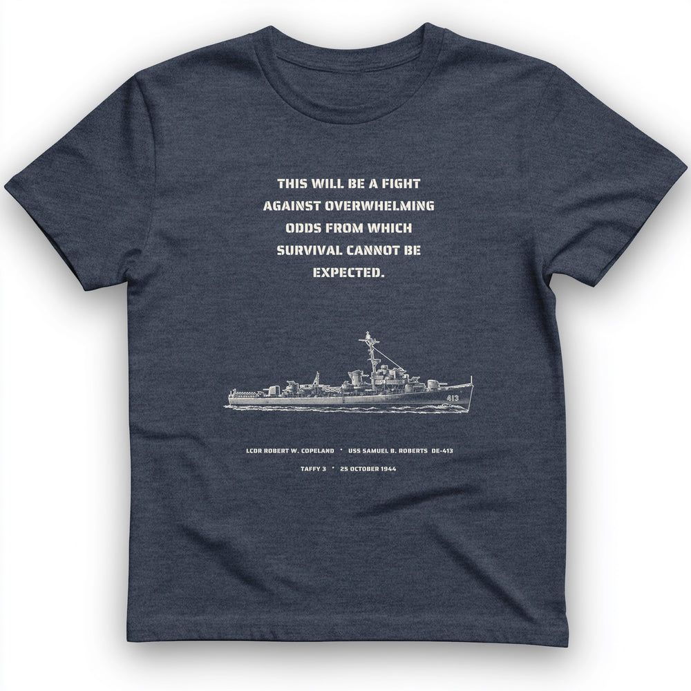

# DLS-HISTOREE-017 — USS Samuel B. Roberts - Last Stand off Samar T-Shirt

Status: collected front-design reference; back placement unverified. No recipe classification.

- Product: https://historeetees.com/products/uss-samuel-b-roberts-last-stand-off-samar-t-shirt
- Seller: HistoreeTees; individual designer unknown.
- Route: https://historeetees.com/collections/recent-best-sellers — default order, observed 2026-10-20, position 13, displayed page 1. Compact feed roster retained; displayed first-page order checked.
- Commercial signal: seller-designated Current Best Sellers collection membership, not audited sales or sales rank.
- Source image: https://cdn.shopify.com/s/files/1/0625/2599/7280/files/H.Navy_USS_Samuel_B._Roberts_-_Last_Stand_off_Samar_T-Shirt_b0cc2e75-27f2-488b-8340-bb0f396a070a.jpg?v=1791326085
- Retained SHA-256: `05b75e26345c4671a2f64fd54cf48576db6c10fe9c038f774ab9d503c7e3b29a`. Unaltered seller CDN rendition, requested width 1000.
- Eligibility: adult physical tee; complete predefined design. Historical people/events are treated as historical subject matter, consistent with the approved HistoreeTees study; not a claim of clearance for reproducing the portraits/artwork. No identified entertainment celebrity or licensed fictional character dependency.
- Placement: visible front graphic; no back-print evidence in product image metadata or description. No affirmative blank-back evidence established, so back remains unverified. Production suitability is separate.
- Seller-listed garment: Gildan 64000 Softstyle unisex preshrunk tee. Solid colors cotton; Sport Grey 90% cotton/10% polyester; Heather Navy 35% cotton/65% polyester. Weight and actual print dimensions unverified.
- Deduplication: new expanded record; recolors count once. No duplicate artwork found within this source batch; global reconciliation pending.

## Visual observation

Five short cream stencil-capital lines sit above a finely drawn ship profile on heather navy, with a conspicuous vertical gap between text and mast. Two tiny identification lines anchor the base. Center-front tall layout, with the ship wider than the text block. Single light-color appearance, extensive negative space and very small technical labels. Heather and fine strokes may reduce legibility; empty space is an observed choice, not an assumed quality advantage.

## Limits

Apparent proportions are qualitative estimates from a mockup. Subject affinity and prior historical knowledge can contribute to appeal. No causal claim about the design, audience demographics, or recipe transfer is made.
