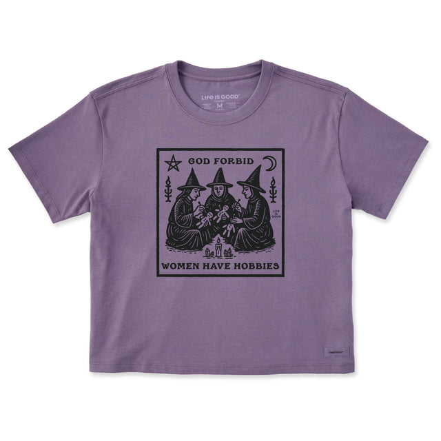

# DLS-LIG-009 — Womens Hobbies Short Sleeve Crusher Boxy Tee

Status: collected front-design reference; back placement unverified. No recipe classification.

- Product: https://lifeisgood.com/products/womens-hobbies-short-sleeve-crusher-boxy-tee
- Seller: Life is Good; individual designer unknown.
- Route: https://lifeisgood.com/collections/best-sellers?sortBy=best_sellers&sortOrder=descending
- Evidence: live browser selected **Best sellers**, 262 collection products, page 1, displayed position 11; observed 2026-10-20. Shopify feed order differs and is not used for positions. Seller ordering is a commercial proxy, not audited unit sales or a disclosed ranking window.
- Source image: https://cdn.shopify.com/s/files/1/0689/2647/2508/files/174814_1_640x.jpg?v=1783606115
- SHA-256: `d65f46101ed96d3e2ca3ac8ec5e74a58d23c81f032b1ef31f910c64b2b95b9d6`. Retained original observed CDN rendition, without alteration; image sizes vary.
- Eligibility: adult tee, complete predefined graphic; optional customization does not make it template-dependent. No identifiable licensed fictional character or celebrity depicted. Brand equity and subject affinity remain confounds.
- Placement: front visible; no affirmative blank-back evidence established. Known sleeve graphics and all-over treatments excluded from front-only sample. Do not certify blank backs from missing views.
- Garment: cut/sleeve/neckline per product title; color and silhouette visible in retained image. Exact fiber composition, weight and physical print dimensions not independently established for this variant unless stated below. Flat product image does not establish on-body drape.
- Deduplication: new ID; prior LIG-001 through 004 reserved for existing research. Repeated artwork across cuts/colors not counted twice; cross-source reconciliation pending.

## Visual observation

Purple boxy crewneck carries a black rectangular occult-style scene with three witches, candles and small symbols. Heavy serif capitals frame the scene at top and bottom; border unifies dense interior details. Single dark ink reads against muted garment, roughly half torso width. Predefined humor/cultural identity is part of appeal; image and wording jointly communicate it.

## Limits

Print proportions are approximate from product photography, not production measurements. Brand marks are observed, not a proposed reusable recipe element. Seasonal demand, garment quality and brand recognition can affect popularity. No demographic or causal sales inference; no family synthesis.
