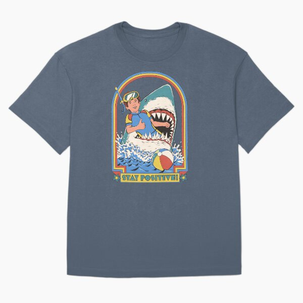

# DLS-RB-001 — Stay Positive Oversized T-Shirt

Status: collected front-design reference; back unverified. No family synthesis.

- Product: https://www.redbubble.com/i/t-shirt/Stay-Positive-by-stevenrhodes/79299073/rh5j
- Creator as displayed: Steven Rhodes; marketplace Redbubble.
- Discovery route: https://www.redbubble.com/shop?gender=gender-men&iaCode=u-tees&sortOrder=top%20selling&includeMatureContent=true
- Capture: 2026-10-20; RB-men, page 1, product-card position 2, **Best Selling** selected in live browser. Promotional inserts are not product positions. No keyword search or style filter applied. Mature-content inclusion is the resulting site URL state.
- Commercial signal: marketplace Best Selling ordering; sales window, counts and ranking formula undisclosed. Not audited sales or evidence that visual treatment caused demand.
- Source image: https://ih1.redbubble.net/image.2404102447.9073/ssrco,oversize_tee,flatlay,445366:bdf0f0f880,front,product_square,x600.jpg
- SHA-256: `929ad78e41b96f3b3b5401dbf2a14bc7a37b8ea28c4ba79adb1eafd207709a41`. Browser media download of the displayed 600px product mockup. No editing; mockup is not a physical sample.
- Eligibility: adult tee; complete predefined design; front graphic visible. No back view checked/blank-back guarantee. No identifiable licensed character or celebrity in accepted image. Cultural allusions, creator reputation and subject affinity may affect appeal.
- Garment: style named by listing; visible cut/color recorded below. Fiber content, physical dimensions and actual ink process unverified. Do not infer precise measurements from mockup.
- Deduplication: new artwork record in this scan; within-route repeated colors/cuts not separately counted; cross-source reconciliation pending.

## Visual observation

Blue-gray oversized tee with tall rounded-arch multicolor frame around vintage-style child/shark scene. Cream, teal, red and yellow create a faded primary-color look; matching yellow condensed headline sits at the bottom. Frame and illustration form a compact upper-chest badge about two-fifths torso width. Fine worn texture and dark comic contrast depend on image and copy jointly.

## Limits

Approximate proportions from image. Thumbnail resolution limits fine texture/type identification. No buyer-demographic inference, exact font identification or recipe-family assignment.
