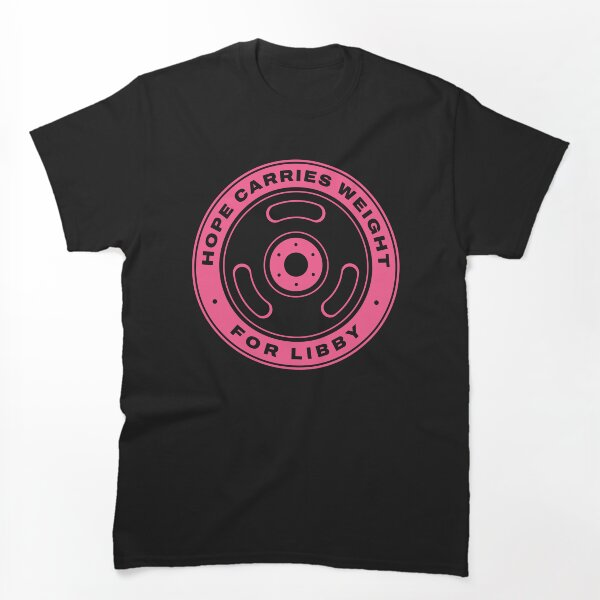

# DLS-RB-006 — Hope Carries Weight Classic T-Shirt

Status: collected front-design reference; back unverified. No family synthesis.

- Product: https://www.redbubble.com/i/t-shirt/Hope-Carries-Weight-by-FromLibbywHope/184402797/lrcw
- Creator as displayed: From Libby With Hope; marketplace Redbubble.
- Discovery route: https://www.redbubble.com/shop?gender=gender-men&iaCode=u-tees&sortOrder=top%20selling&includeMatureContent=true
- Capture: 2026-10-20; RB-men, page 1, product-card position 8, **Best Selling** selected in live browser. Promotional inserts are not product positions. No keyword search or style filter applied. Mature-content inclusion is the resulting site URL state.
- Commercial signal: marketplace Best Selling ordering; sales window, counts and ranking formula undisclosed. Not audited sales or evidence that visual treatment caused demand.
- Source image: https://ih1.redbubble.net/image.6251454754.2797/ssrco,classic_tee,flatlay_01,101010:01c5ca27c6,front,product_square,x600.1.jpg
- SHA-256: `0fbf89eb63876216edab85feda8ba863c7632d964967f10f0b89c7263da7d989`. Browser media download of the displayed 600px product mockup. No editing; mockup is not a physical sample.
- Eligibility: adult tee; complete predefined design; front graphic visible. No back view checked/blank-back guarantee. No identifiable licensed character or celebrity in accepted image. Cultural allusions, creator reputation and subject affinity may affect appeal.
- Garment: style named by listing; visible cut/color recorded below. Fiber content, physical dimensions and actual ink process unverified. Do not infer precise measurements from mockup.
- Deduplication: new artwork record in this scan; within-route repeated colors/cuts not separately counted; cross-source reconciliation pending.

## Visual observation

Black classic crewneck with a large pink weight-plate circle. Bold uppercase text runs around outer ring; center hole and three grip apertures use garment negative space. Uniform one-color geometry and concentric outlines create a strong gym badge. The named support message is campaign-specific; willingness to buy may reflect solidarity rather than aesthetics. Not a proposed reusable slogan.

## Limits

Approximate proportions from image. Thumbnail resolution limits fine texture/type identification. No buyer-demographic inference, exact font identification or recipe-family assignment.
