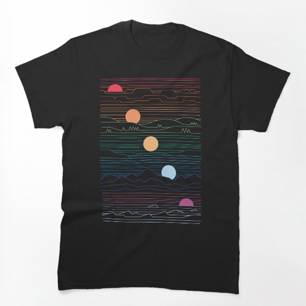

# DLS-RB-008 — Many Lands Under One Sun Classic T-Shirt

Status: collected front-design reference; back unverified. No family synthesis.

- Product: https://www.redbubble.com/i/t-shirt/Many-Lands-Under-One-Sun-by-thepapercrane/22317419/lrcw
- Creator as displayed: thepapercrane; marketplace Redbubble.
- Discovery route: https://www.redbubble.com/shop?gender=gender-men&iaCode=u-tees&sortOrder=top%20selling&includeMatureContent=true
- Capture: 2026-10-20; RB-men, page 1, product-card position 10, **Best Selling** selected in live browser. Promotional inserts are not product positions. No keyword search or style filter applied. Mature-content inclusion is the resulting site URL state.
- Commercial signal: marketplace Best Selling ordering; sales window, counts and ranking formula undisclosed. Not audited sales or evidence that visual treatment caused demand.
- Source image: https://ih1.redbubble.net/image.6144991698.7419/ssrco,classic_tee,flatlay_01,101010:01c5ca27c6,front,product_square,x600.1u2.jpg
- SHA-256: `ecde653020c6a30d316a690e0bf784158530c557f43a8e33d18ba3f5799c0415`. Browser media download of the displayed 600px product mockup. No editing; mockup is not a physical sample.
- Eligibility: adult tee; complete predefined design; front graphic visible. No back view checked/blank-back guarantee. No identifiable licensed character or celebrity in accepted image. Cultural allusions, creator reputation and subject affinity may affect appeal.
- Garment: style named by listing; visible cut/color recorded below. Fiber content, physical dimensions and actual ink process unverified. Do not infer precise measurements from mockup.
- Deduplication: new artwork record in this scan; within-route repeated colors/cuts not separately counted; cross-source reconciliation pending.

## Visual observation

Black classic crewneck with tall rectangular field of very fine horizontal colored lines, stepped into mountain/water contours. Five colored circular suns descend diagonally; line colors shift from warm red/orange above to cool blue/purple below. No copy. Thin-line density creates a graphic rectangle without a solid background panel; about half torso width and much greater height.

## Limits

Approximate proportions from image. Thumbnail resolution limits fine texture/type identification. No buyer-demographic inference, exact font identification or recipe-family assignment.
