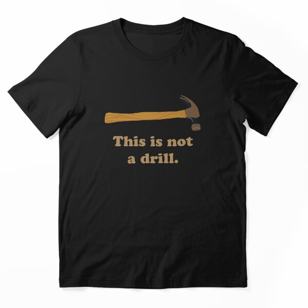

# DLS-RB-010 — Hammer - This is Not a Drill Essential T-Shirt

Status: collected front-design reference; back unverified. No family synthesis.

- Product: https://www.redbubble.com/i/t-shirt/Hammer-This-is-Not-a-Drill-by-TheShirtYurt/12667964/z5wf
- Creator as displayed: TheShirtYurt; marketplace Redbubble.
- Discovery route: https://www.redbubble.com/shop?gender=gender-men&iaCode=u-tees&sortOrder=top%20selling&includeMatureContent=true
- Capture: 2026-10-20; RB-men, page 1, product-card position 12, **Best Selling** selected in live browser. Promotional inserts are not product positions. No keyword search or style filter applied. Mature-content inclusion is the resulting site URL state.
- Commercial signal: marketplace Best Selling ordering; sales window, counts and ranking formula undisclosed. Not audited sales or evidence that visual treatment caused demand.
- Source image: https://ih1.redbubble.net/image.28605752.7964/ssrco,essential_tee,flatlay_01,101010:01c5ca27c6,front,product_square,x600.jpg
- SHA-256: `a1a1d0cb5cc3f76ad2259a32ee535f749f502f0089375cb9403ed264d5b78d46`. Browser media download of the displayed 600px product mockup. No editing; mockup is not a physical sample.
- Eligibility: adult tee; complete predefined design; front graphic visible. No back view checked/blank-back guarantee. No identifiable licensed character or celebrity in accepted image. Cultural allusions, creator reputation and subject affinity may affect appeal.
- Garment: style named by listing; visible cut/color recorded below. Fiber content, physical dimensions and actual ink process unverified. Do not infer precise measurements from mockup.
- Deduplication: new artwork record in this scan; within-route repeated colors/cuts not separately counted; cross-source reconciliation pending.

## Visual observation

Black essential tee with horizontal hammer above two centered tan heavy-serif lines. Golden wood handle and brown/gray metal echo warm copy color, with minimal shading and no border. Illustration and copy have similar width; substantial empty garment around the shallow composition. Literal tool illustration supplies the joke’s visual clarification.

## Limits

Approximate proportions from image. Thumbnail resolution limits fine texture/type identification. No buyer-demographic inference, exact font identification or recipe-family assignment.
