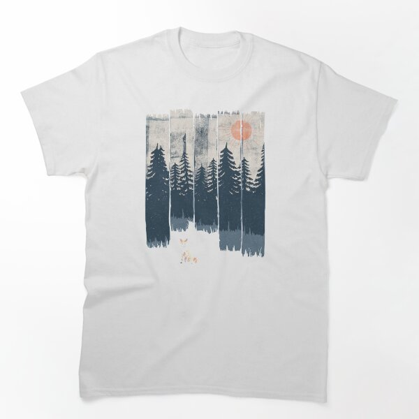

# DLS-RB-012 — A Fox in the Wild... Classic T-Shirt

Status: collected front-design reference; back unverified. No family synthesis.

- Product: https://www.redbubble.com/i/t-shirt/A-Fox-in-the-Wild-by-ndtank/20726125/lrcw
- Creator as displayed: ndtank; marketplace Redbubble.
- Discovery route: https://www.redbubble.com/shop?gender=gender-men&iaCode=u-tees&sortOrder=top%20selling&includeMatureContent=true
- Capture: 2026-10-20; RB-men, page 1, product-card position 14, **Best Selling** selected in live browser. Promotional inserts are not product positions. No keyword search or style filter applied. Mature-content inclusion is the resulting site URL state.
- Commercial signal: marketplace Best Selling ordering; sales window, counts and ranking formula undisclosed. Not audited sales or evidence that visual treatment caused demand.
- Source image: https://ih1.redbubble.net/image.1165884187.6125/ssrco,classic_tee,flatlay_01,fafafa:ca443f4786,front,product_square,x600.1.jpg
- SHA-256: `d55a141bfade5841024fa216e620bd383c27641768e468cd53e731ce2c3cc50c`. Browser media download of the displayed 600px product mockup. No editing; mockup is not a physical sample.
- Eligibility: adult tee; complete predefined design; front graphic visible. No back view checked/blank-back guarantee. No identifiable licensed character or celebrity in accepted image. Cultural allusions, creator reputation and subject affinity may affect appeal.
- Garment: style named by listing; visible cut/color recorded below. Fiber content, physical dimensions and actual ink process unverified. Do not infer precise measurements from mockup.
- Deduplication: new artwork record in this scan; within-route repeated colors/cuts not separately counted; cross-source reconciliation pending.

## Visual observation

White classic tee with a tall forest scene rendered in dark blue-gray, faded gray and muted orange sun. Vertical distressed strips evoke weathered printing; tree silhouettes merge into a large mass while white negative space opens a path containing a tiny fox. No type. Narrow scene about two-fifths torso width; rough edges avoid a clean rectangular poster panel.

## Limits

Approximate proportions from image. Thumbnail resolution limits fine texture/type identification. No buyer-demographic inference, exact font identification or recipe-family assignment.
