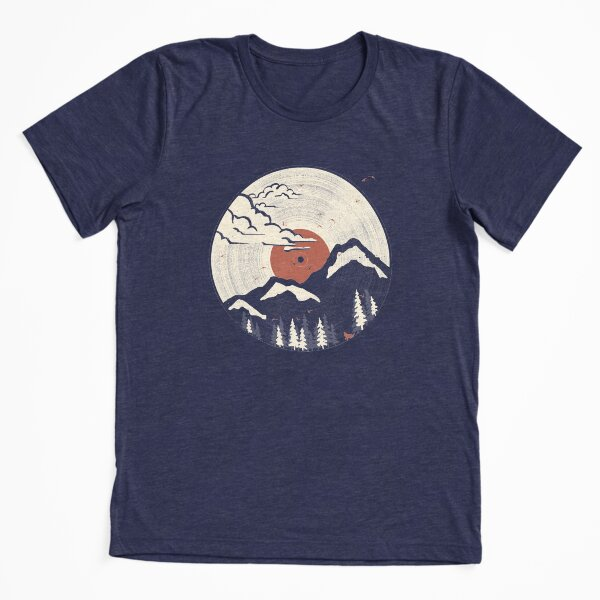

# DLS-RB-015 — MTN LP... Extra Soft T-Shirt

Status: collected front-design reference; back unverified. No family synthesis.

- Product: https://www.redbubble.com/i/t-shirt/MTN-LP-by-ndtank/21013490/4d7w
- Creator as displayed: ndtank; marketplace Redbubble.
- Discovery route: https://www.redbubble.com/shop?gender=gender-men&iaCode=u-tees&sortOrder=top%20selling&includeMatureContent=true
- Capture: 2026-10-20; RB-men, page 1, product-card position 17, **Best Selling** selected in live browser. Promotional inserts are not product positions. No keyword search or style filter applied. Mature-content inclusion is the resulting site URL state.
- Commercial signal: marketplace Best Selling ordering; sales window, counts and ranking formula undisclosed. Not audited sales or evidence that visual treatment caused demand.
- Source image: https://ih1.redbubble.net/image.339900741.3490/ssrco,triblend_tee,flatlay,triblend_navy,front,square_product,x600.1u4.jpg
- SHA-256: `12ca284d7bb1bd8a5353215eb835c792dc575dc64e6d53b5baa6de0e35275f55`. Browser media download of the displayed 600px product mockup. No editing; mockup is not a physical sample.
- Eligibility: adult tee; complete predefined design; front graphic visible. No back view checked/blank-back guarantee. No identifiable licensed character or celebrity in accepted image. Cultural allusions, creator reputation and subject affinity may affect appeal.
- Garment: style named by listing; visible cut/color recorded below. Fiber content, physical dimensions and actual ink process unverified. Do not infer precise measurements from mockup.
- Deduplication: new artwork record in this scan; within-route repeated colors/cuts not separately counted; cross-source reconciliation pending.

## Visual observation

Heather-navy Extra Soft tee with cream circular vinyl-record motif merging with mountain landscape and trees. Rust record label doubles as sun; mountain silhouettes cut through circle using garment color. Tiny deer and birds add secondary detail. Fine concentric grooves/distress sit behind large simple forms; centered circle about half torso width, no headline.

## Limits

Approximate proportions from image. Thumbnail resolution limits fine texture/type identification. No buyer-demographic inference, exact font identification or recipe-family assignment.
