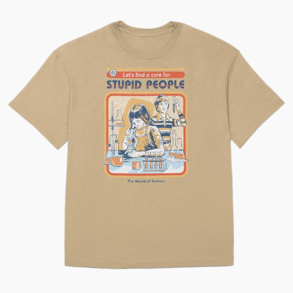

# DLS-RB-017 — A Cure For Stupid People Oversized T-Shirt

Status: collected front-design reference; back unverified. No family synthesis.

- Product: https://www.redbubble.com/i/t-shirt/A-Cure-For-Stupid-People-by-stevenrhodes/36339198/rh5j
- Creator as displayed: Steven Rhodes; marketplace Redbubble.
- Discovery route: https://www.redbubble.com/shop?gender=gender-men&iaCode=u-tees&sortOrder=top%20selling&includeMatureContent=true
- Capture: 2026-10-20; RB-men, page 1, product-card position 19, **Best Selling** selected in live browser. Promotional inserts are not product positions. No keyword search or style filter applied. Mature-content inclusion is the resulting site URL state.
- Commercial signal: marketplace Best Selling ordering; sales window, counts and ranking formula undisclosed. Not audited sales or evidence that visual treatment caused demand.
- Source image: https://ih1.redbubble.net/image.725041718.9198/ssrco,oversize_tee,flatlay,c9ab81:b45db13379,front,product_square,x600.u7.jpg
- SHA-256: `d35967d290ff5ca395c96765e3e1c88a8012a4d7e21b5e10b6f004b02a158b50`. Browser media download of the displayed 600px product mockup. No editing; mockup is not a physical sample.
- Eligibility: adult tee; complete predefined design; front graphic visible. No back view checked/blank-back guarantee. No identifiable licensed character or celebrity in accepted image. Cultural allusions, creator reputation and subject affinity may affect appeal.
- Garment: style named by listing; visible cut/color recorded below. Fiber content, physical dimensions and actual ink process unverified. Do not infer precise measurements from mockup.
- Deduplication: new artwork record in this scan; within-route repeated colors/cuts not separately counted; cross-source reconciliation pending.

## Visual observation

Tan oversized tee with retro educational-book style science scene inside a rounded orange frame. Blue/cream line art of children and laboratory equipment overlaps frame; orange header strip and larger blue title sit above, tiny footer below. Weathered texture spans image/type. Tall compact central print leaves wide garment margins; visual sweetness supports dark joke context.

## Limits

Approximate proportions from image. Thumbnail resolution limits fine texture/type identification. No buyer-demographic inference, exact font identification or recipe-family assignment.
