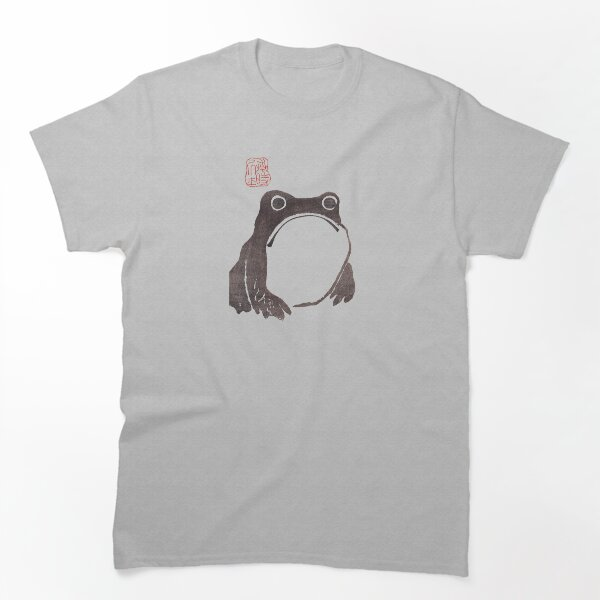

# DLS-RB-021 — Grumpy Frog - Matsumoto Hoji Classic T-Shirt

Status: collected front-design reference; back unverified. No family synthesis.

- Product: https://www.redbubble.com/i/t-shirt/Grumpy-Frog-Matsumoto-Hoji-by-nphindenberg/57170597/lrcw.XYZ
- Creator as displayed: nphindenberg; marketplace Redbubble.
- Discovery route: https://www.redbubble.com/shop?gender=gender-women&iaCode=u-tees&sortOrder=top%20selling&includeMatureContent=true
- Capture: 2026-10-20; RB-women, page 1, product-card position 23, **Best Selling** selected in live browser. Promotional inserts are not product positions. No keyword search or style filter applied. Mature-content inclusion is the resulting site URL state.
- Commercial signal: marketplace Best Selling ordering; sales window, counts and ranking formula undisclosed. Not audited sales or evidence that visual treatment caused demand.
- Source image: https://ih1.redbubble.net/image.2440452207.0597/ssrco,classic_tee,flatlay_01,heather_light_grey,front,product_square,x600.1.jpg
- SHA-256: `a8312477b3efc232f4a5f545a2a80fee3c7a61dc7c719a87ba1e4721794bc5e0`. Browser media download of the displayed 600px product mockup. No editing; mockup is not a physical sample.
- Eligibility: adult tee; complete predefined design; front graphic visible. No back view checked/blank-back guarantee. No identifiable licensed character or celebrity in accepted image. Cultural allusions, creator reputation and subject affinity may affect appeal.
- Garment: style named by listing; visible cut/color recorded below. Fiber content, physical dimensions and actual ink process unverified. Do not infer precise measurements from mockup.
- Deduplication: new artwork record in this scan; within-route repeated colors/cuts not separately counted; cross-source reconciliation pending.

## Visual observation

Heather-gray classic tee with compact brown brush/woodblock-style frog. Large pale belly is garment negative space; simple circular eyes and sagging mouth carry expression. Small faded-red seal above-left provides the only accent. No main headline; about one-third torso width, sparse and vertically centered on upper chest. Historical-art attribution is listing text, not independently authenticated.

## Limits

Approximate proportions from image. Thumbnail resolution limits fine texture/type identification. No buyer-demographic inference, exact font identification or recipe-family assignment.
