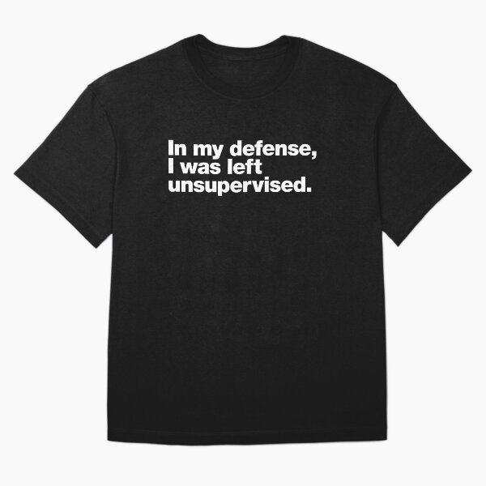

# DLS-RB-022 — In my defense, I was left unsupervised. Oversized T-Shirt

Status: collected front-design reference; back unverified. No family synthesis.

- Product: https://www.redbubble.com/i/t-shirt/In-my-defense-I-was-left-unsupervised-by-chestify/35016188/rh5j.XYZ
- Creator as displayed: chestify; marketplace Redbubble.
- Discovery route: https://www.redbubble.com/shop?gender=gender-women&iaCode=u-tees&sortOrder=top%20selling&includeMatureContent=true
- Capture: 2026-10-20; RB-women, page 1, product-card position 24, **Best Selling** selected in live browser. Promotional inserts are not product positions. No keyword search or style filter applied. Mature-content inclusion is the resulting site URL state.
- Commercial signal: marketplace Best Selling ordering; sales window, counts and ranking formula undisclosed. Not audited sales or evidence that visual treatment caused demand.
- Source image: https://ih1.redbubble.net/image.5975499339.6188/ssrco,oversize_tee,flatlay,000000:44f0b734a5,front,product_square,x600.u1.jpg
- SHA-256: `06f457708ddb87a44a87ce706761b805b3da3ce12c7674e32b1de700f261fd00`. Browser media download of the displayed 600px product mockup. No editing; mockup is not a physical sample.
- Eligibility: adult tee; complete predefined design; front graphic visible. No back view checked/blank-back guarantee. No identifiable licensed character or celebrity in accepted image. Cultural allusions, creator reputation and subject affinity may affect appeal.
- Garment: style named by listing; visible cut/color recorded below. Fiber content, physical dimensions and actual ink process unverified. Do not infer precise measurements from mockup.
- Deduplication: new artwork record in this scan; within-route repeated colors/cuts not separately counted; cross-source reconciliation pending.

## Visual observation

Black oversized tee with three tight white bold sans-serif lines, left aligned within a compact chest block. Similar letter size/weight across sentence; no illustration or decoration. Approximately two-fifths torso width and shallow height; long last word determines block width. Creator’s repeat typography across different messages must not be treated as independent seller evidence.

## Limits

Approximate proportions from image. Thumbnail resolution limits fine texture/type identification. No buyer-demographic inference, exact font identification or recipe-family assignment.
