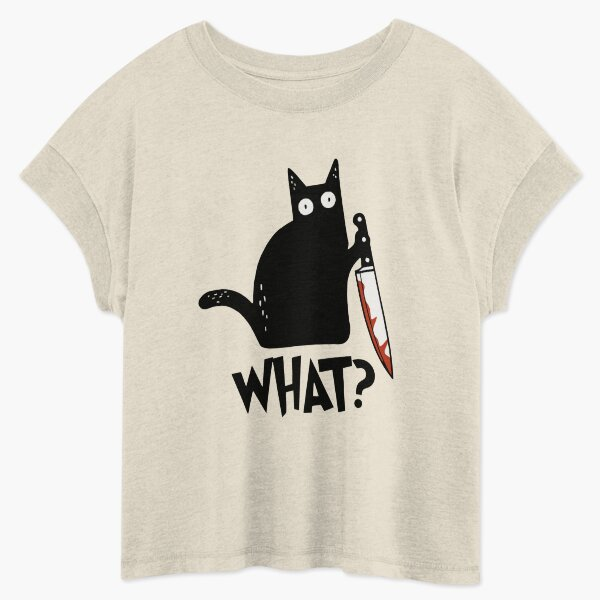

# DLS-RB-024 — Cat What? Murderous Black Cat With Knife Gift Premium T-Shirt Relaxed T-Shirt

Status: collected front-design reference; back unverified. No family synthesis.

- Product: https://www.redbubble.com/i/t-shirt/Cat-What-Murderous-Black-Cat-With-Knife-Gift-Premium-T-Shirt-by-ZeLittleFamily/43523705/xmcg.XYZ
- Creator as displayed: ZeLittleFamily; marketplace Redbubble.
- Discovery route: https://www.redbubble.com/shop?gender=gender-women&iaCode=u-tees&sortOrder=top%20selling&includeMatureContent=true
- Capture: 2026-10-20; RB-women, page 1, product-card position 26, **Best Selling** selected in live browser. Promotional inserts are not product positions. No keyword search or style filter applied. Mature-content inclusion is the resulting site URL state.
- Commercial signal: marketplace Best Selling ordering; sales window, counts and ranking formula undisclosed. Not audited sales or evidence that visual treatment caused demand.
- Source image: https://ih1.redbubble.net/image.3650090745.3705/ssrco,relaxed_tshirt,flatlay_01,ebe3d1:09f0675ce6,front,product_square,x600.u1.jpg
- SHA-256: `d7c9738ceb0ff340a98c512b97c6ca0ecd04ae1a6b5d75ded210082956459daf`. Browser media download of the displayed 600px product mockup. No editing; mockup is not a physical sample.
- Eligibility: adult tee; complete predefined design; front graphic visible. No back view checked/blank-back guarantee. No identifiable licensed character or celebrity in accepted image. Cultural allusions, creator reputation and subject affinity may affect appeal.
- Garment: style named by listing; visible cut/color recorded below. Fiber content, physical dimensions and actual ink process unverified. Do not infer precise measurements from mockup.
- Deduplication: new artwork record in this scan; within-route repeated colors/cuts not separately counted; cross-source reconciliation pending.

## Visual observation

Cream relaxed tee with a large black cat silhouette holding a knife, small white eyes and red blade accent. Jagged heavy uppercase word below tilts irregularly and echoes comic surprise; black shape dominates. Tall composition around half torso width, without border; red is a tiny but salient focal accent. Mockup shows looser/dropped shoulder shape, not measured fit.

## Limits

Approximate proportions from image. Thumbnail resolution limits fine texture/type identification. No buyer-demographic inference, exact font identification or recipe-family assignment.
