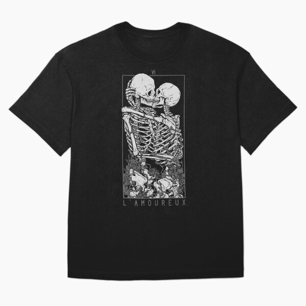

# DLS-RB-027 — The Lovers Oversized T-Shirt

Status: collected front-design reference; back unverified. No family synthesis.

- Product: https://www.redbubble.com/i/t-shirt/The-Lovers-by-deniart/27240325/rh5j.XYZ
- Creator as displayed: deniart; marketplace Redbubble.
- Discovery route: https://www.redbubble.com/shop?gender=gender-women&iaCode=u-tees&sortOrder=top%20selling&includeMatureContent=true
- Capture: 2026-10-20; RB-women, page 1, product-card position 29, **Best Selling** selected in live browser. Promotional inserts are not product positions. No keyword search or style filter applied. Mature-content inclusion is the resulting site URL state.
- Commercial signal: marketplace Best Selling ordering; sales window, counts and ranking formula undisclosed. Not audited sales or evidence that visual treatment caused demand.
- Source image: https://ih1.redbubble.net/image.400082512.0325/ssrco,oversize_tee,flatlay,000000:44f0b734a5,front,product_square,x600.u3.jpg
- SHA-256: `5de1363960fa33b83d48032bdcae23e5c94ce6f3f7918dfd56bac7895b3b79ca`. Browser media download of the displayed 600px product mockup. No editing; mockup is not a physical sample.
- Eligibility: adult tee; complete predefined design; front graphic visible. No back view checked/blank-back guarantee. No identifiable licensed character or celebrity in accepted image. Cultural allusions, creator reputation and subject affinity may affect appeal.
- Garment: style named by listing; visible cut/color recorded below. Fiber content, physical dimensions and actual ink process unverified. Do not infer precise measurements from mockup.
- Deduplication: new artwork record in this scan; within-route repeated colors/cuts not separately counted; cross-source reconciliation pending.

## Visual observation

Black oversized tee with tall narrow monochrome skeleton embrace and roses, a thin rectangular border, small numeral above and widely tracked condensed title below. Dense engraved shading contrasts with light bone highlights; garment supplies black shadows. Narrow panel about one-third torso width. Tarot-like structure is a visual reference, not an inferred buyer demographic.

## Limits

Approximate proportions from image. Thumbnail resolution limits fine texture/type identification. No buyer-demographic inference, exact font identification or recipe-family assignment.
