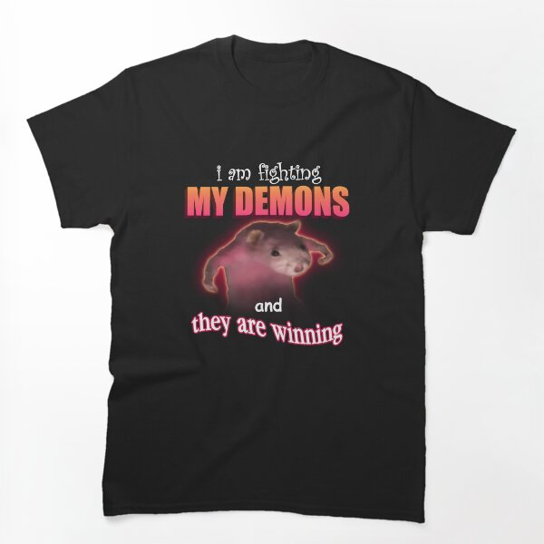

# DLS-RB-031 — I'm fighting my demons and they are winning word art meme Classic T-Shirt

Status: collected front-design reference; back unverified. No family synthesis.

- Product: https://www.redbubble.com/i/t-shirt/I-m-fighting-my-demons-and-they-are-winning-word-art-meme-by-snazzyseagull/144792371/lrcw.XYZ
- Creator as displayed: snazzyseagull; marketplace Redbubble.
- Discovery route: https://www.redbubble.com/shop?gender=gender-women&iaCode=u-tees&sortOrder=top%20selling&includeMatureContent=true
- Capture: 2026-10-20; RB-women, page 1, product-card position 35, **Best Selling** selected in live browser. Promotional inserts are not product positions. No keyword search or style filter applied. Mature-content inclusion is the resulting site URL state.
- Commercial signal: marketplace Best Selling ordering; sales window, counts and ranking formula undisclosed. Not audited sales or evidence that visual treatment caused demand.
- Source image: https://ih1.redbubble.net/image.4973911033.2371/ssrco,classic_tee,flatlay_01,101010:01c5ca27c6,front,product_square,x600.1u2.jpg
- SHA-256: `5a590a34d2dccc6647e9cb8a2d33cf0da94ad7f5432c4046374dfb28a42ff27b`. Browser media download of the displayed 600px product mockup. No editing; mockup is not a physical sample.
- Eligibility: adult tee; complete predefined design; front graphic visible. No back view checked/blank-back guarantee. No identifiable licensed character or celebrity in accepted image. Cultural allusions, creator reputation and subject affinity may affect appeal.
- Garment: style named by listing; visible cut/color recorded below. Fiber content, physical dimensions and actual ink process unverified. Do not infer precise measurements from mockup.
- Deduplication: new artwork record in this scan; within-route repeated colors/cuts not separately counted; cross-source reconciliation pending.

## Visual observation

Black classic tee with small photographic hamster cutout surrounded by red/orange glow. Mixed word-art styles stack above and below: ornate white small text, very heavy warm-gradient uppercase emphasis, curved white/red-shadow closing line. Deliberately mismatched type and glow create an internet-meme impression. Compact central vertical block, image and emphasized words competing for first read.

## Limits

Approximate proportions from image. Thumbnail resolution limits fine texture/type identification. No buyer-demographic inference, exact font identification or recipe-family assignment.
