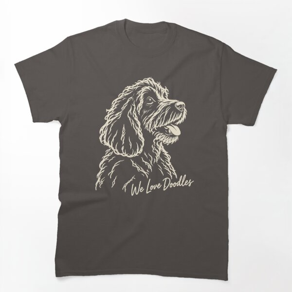

# DLS-RB-033 — We Love Doodles Cream Dog Portrait Classic T-Shirt

Status: collected front-design reference; back unverified. No family synthesis.

- Product: https://www.redbubble.com/i/t-shirt/We-Love-Doodles-Cream-Dog-Portrait-by-welovedoodles/184506498/lrcw.XYZ
- Creator as displayed: welovedoodles; marketplace Redbubble.
- Discovery route: https://www.redbubble.com/shop?gender=gender-women&iaCode=u-tees&sortOrder=top%20selling&includeMatureContent=true
- Capture: 2026-10-20; RB-women, page 1, product-card position 37, **Best Selling** selected in live browser. Promotional inserts are not product positions. No keyword search or style filter applied. Mature-content inclusion is the resulting site URL state.
- Commercial signal: marketplace Best Selling ordering; sales window, counts and ranking formula undisclosed. Not audited sales or evidence that visual treatment caused demand.
- Source image: https://ih1.redbubble.net/image.6258191934.6498/ssrco,classic_tee,flatlay_01,4a4440:cc103efb7a,front,product_square,x600.1.jpg
- SHA-256: `702820feae214c0000ffd48ee12ab957246c741eb3264d342cee8b377707c002`. Browser media download of the displayed 600px product mockup. No editing; mockup is not a physical sample.
- Eligibility: adult tee; complete predefined design; front graphic visible. No back view checked/blank-back guarantee. No identifiable licensed character or celebrity in accepted image. Cultural allusions, creator reputation and subject affinity may affect appeal.
- Garment: style named by listing; visible cut/color recorded below. Fiber content, physical dimensions and actual ink process unverified. Do not infer precise measurements from mockup.
- Deduplication: new artwork record in this scan; within-route repeated colors/cuts not separately counted; cross-source reconciliation pending.

## Visual observation

Dark taupe classic tee with a large cream line-drawn dog portrait and small cursive sentiment along lower right. Fur is built from flowing broken strokes, with garment as shadows; bright eye/muzzle contours guide focus. No enclosing shape; tall head/shoulder silhouette about half torso width. Breed affinity may be more important than illustration treatment to buyers.

## Limits

Approximate proportions from image. Thumbnail resolution limits fine texture/type identification. No buyer-demographic inference, exact font identification or recipe-family assignment.
