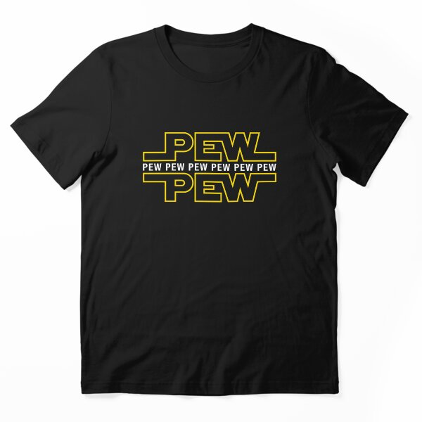

# DLS-RB-034 — Pew Pew Pew Essential T-Shirt

Status: collected front-design reference; back unverified. No family synthesis.

- Product: https://www.redbubble.com/i/t-shirt/Pew-Pew-Pew-by-Purakushi/31256685/z5wf.XYZ
- Creator as displayed: Candywrap Studio; marketplace Redbubble.
- Discovery route: https://www.redbubble.com/shop?gender=gender-women&iaCode=u-tees&sortOrder=top%20selling&includeMatureContent=true
- Capture: 2026-10-20; RB-women, page 1, product-card position 38, **Best Selling** selected in live browser. Promotional inserts are not product positions. No keyword search or style filter applied. Mature-content inclusion is the resulting site URL state.
- Commercial signal: marketplace Best Selling ordering; sales window, counts and ranking formula undisclosed. Not audited sales or evidence that visual treatment caused demand.
- Source image: https://ih1.redbubble.net/image.546716265.6685/ssrco,essential_tee,flatlay_01,101010:01c5ca27c6,front,product_square,x600.u12.jpg
- SHA-256: `eb432d4815b17bf41ceba9235d9a0b23a718113ea0322879a01c4190f95e13b1`. Browser media download of the displayed 600px product mockup. No editing; mockup is not a physical sample.
- Eligibility: adult tee; complete predefined design; front graphic visible. No back view checked/blank-back guarantee. No identifiable licensed character or celebrity in accepted image. Cultural allusions, creator reputation and subject affinity may affect appeal.
- Garment: style named by listing; visible cut/color recorded below. Fiber content, physical dimensions and actual ink process unverified. Do not infer precise measurements from mockup.
- Deduplication: new artwork record in this scan; within-route repeated colors/cuts not separately counted; cross-source reconciliation pending.

## Visual observation

Black essential tee with two heavy geometric outlined yellow words above/below a narrow white repeated-word line. Extended horizontal letter strokes form a compact symmetrical logo-like block; garment fills letter interiors. Broad but shallow upper-chest placement. Clear science-fiction logo-style allusion is part of recognition; no characters are depicted, and this is not a reusable-logo recommendation.

## Limits

Approximate proportions from image. Thumbnail resolution limits fine texture/type identification. No buyer-demographic inference, exact font identification or recipe-family assignment.
