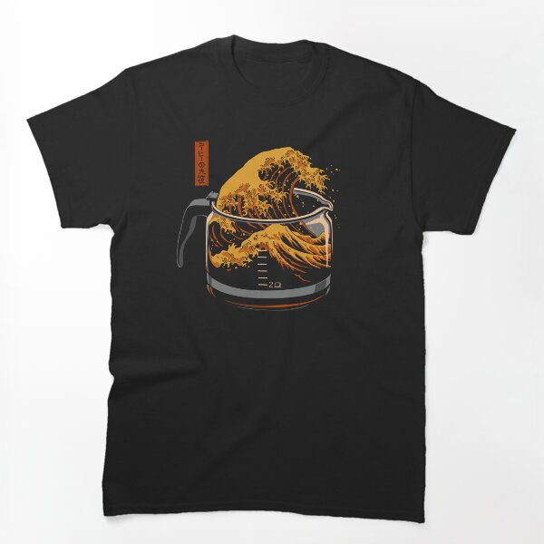

# DLS-RB-035 — The Great Wave of Coffee Classic T-Shirt

Status: collected front-design reference; back unverified. No family synthesis.

- Product: https://www.redbubble.com/i/t-shirt/The-Great-Wave-of-Coffee-by-Gloopz/68660035/lrcw.XYZ
- Creator as displayed: Elan Harris; marketplace Redbubble.
- Discovery route: https://www.redbubble.com/shop?gender=gender-women&iaCode=u-tees&sortOrder=top%20selling&includeMatureContent=true
- Capture: 2026-10-20; RB-women, page 1, product-card position 40, **Best Selling** selected in live browser. Promotional inserts are not product positions. No keyword search or style filter applied. Mature-content inclusion is the resulting site URL state.
- Commercial signal: marketplace Best Selling ordering; sales window, counts and ranking formula undisclosed. Not audited sales or evidence that visual treatment caused demand.
- Source image: https://ih1.redbubble.net/image.6186083549.0035/ssrco,classic_tee,flatlay_01,101010:01c5ca27c6,front,product_square,x600.1.jpg
- SHA-256: `8d4648e794a9a7304b2739f7a1944d6e5422e7be26b1782d74b59abdad6ca678`. Browser media download of the displayed 600px product mockup. No editing; mockup is not a physical sample.
- Eligibility: adult tee; complete predefined design; front graphic visible. No back view checked/blank-back guarantee. No identifiable licensed character or celebrity in accepted image. Cultural allusions, creator reputation and subject affinity may affect appeal.
- Garment: style named by listing; visible cut/color recorded below. Fiber content, physical dimensions and actual ink process unverified. Do not infer precise measurements from mockup.
- Deduplication: new artwork record in this scan; within-route repeated colors/cuts not separately counted; cross-source reconciliation pending.

## Visual observation

Black classic tee with orange/gold crashing wave rising out of a gray outlined coffee carafe. Wave detail uses fine linework and garment negative space; small vertical orange text cartouche sits to upper left. No main slogan. Compact central illustration around half torso width, irregular crest breaks vessel outline; historical print allusion and coffee identity are separate appeal confounds.

## Limits

Approximate proportions from image. Thumbnail resolution limits fine texture/type identification. No buyer-demographic inference, exact font identification or recipe-family assignment.
