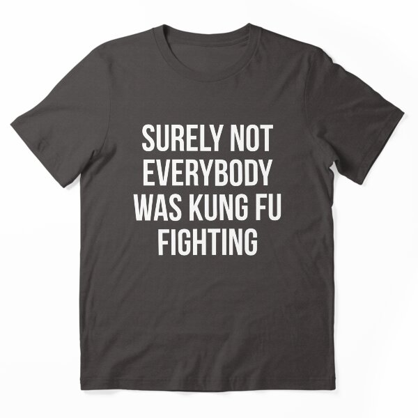

# DLS-RB-036 — Surely Not Everybody Was Kung Fu Fighting Essential T-Shirt

Status: collected front-design reference; back unverified. No family synthesis.

- Product: https://www.redbubble.com/i/t-shirt/Surely-Not-Everybody-Was-Kung-Fu-Fighting-by-kjanedesigns/23569322/z5wf.XYZ
- Creator as displayed: kjanedesigns; marketplace Redbubble.
- Discovery route: https://www.redbubble.com/shop?gender=gender-women&iaCode=u-tees&sortOrder=top%20selling&includeMatureContent=true
- Capture: 2026-10-20; RB-women, page 1, product-card position 41, **Best Selling** selected in live browser. Promotional inserts are not product positions. No keyword search or style filter applied. Mature-content inclusion is the resulting site URL state.
- Commercial signal: marketplace Best Selling ordering; sales window, counts and ranking formula undisclosed. Not audited sales or evidence that visual treatment caused demand.
- Source image: https://ih1.redbubble.net/image.270945233.9322/ssrco,essential_tee,flatlay_01,heather_charcoal_grey,front,product_square,x600.jpg
- SHA-256: `74da6222762aca767ab8124a0cba8ac3760312e1ee9bdc73e29021cf969feee4`. Browser media download of the displayed 600px product mockup. No editing; mockup is not a physical sample.
- Eligibility: adult tee; complete predefined design; front graphic visible. No back view checked/blank-back guarantee. No identifiable licensed character or celebrity in accepted image. Cultural allusions, creator reputation and subject affinity may affect appeal.
- Garment: style named by listing; visible cut/color recorded below. Fiber content, physical dimensions and actual ink process unverified. Do not infer precise measurements from mockup.
- Deduplication: new artwork record in this scan; within-route repeated colors/cuts not separately counted; cross-source reconciliation pending.

## Visual observation

Dark taupe essential tee with four centered lines of white condensed uppercase copy. Similar letter height/weight throughout; narrow letterforms allow long sentence to fit a tall rectangular block about half torso width. No illustration. Song allusion is a semantic recognition confound; typography alone does not explain demand.

## Limits

Approximate proportions from image. Thumbnail resolution limits fine texture/type identification. No buyer-demographic inference, exact font identification or recipe-family assignment.
