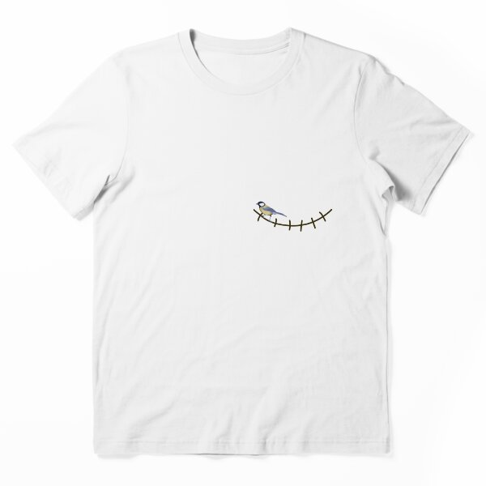

# DLS-RB-038 — Uniboober - Mastectomy - "Great tit" left -position1 Essential T-Shirt

Status: collected front-design reference; back unverified. No family synthesis.

- Product: https://www.redbubble.com/i/t-shirt/Uniboober-Mastectomy-Great-tit-left-position1-by-UniSturm/184326977/z5wf.XYZ
- Creator as displayed: UniSturm; marketplace Redbubble.
- Discovery route: https://www.redbubble.com/shop?gender=gender-women&iaCode=u-tees&sortOrder=top%20selling&includeMatureContent=true
- Capture: 2026-10-20; RB-women, page 1, product-card position 45, **Best Selling** selected in live browser. Promotional inserts are not product positions. No keyword search or style filter applied. Mature-content inclusion is the resulting site URL state.
- Commercial signal: marketplace Best Selling ordering; sales window, counts and ranking formula undisclosed. Not audited sales or evidence that visual treatment caused demand.
- Source image: https://ih1.redbubble.net/image.6247076418.6977/ssrco,essential_tee,flatlay_01,fafafa:ca443f4786,front,product_square,x600.u1.jpg
- SHA-256: `a45e440b823fbded9bb72a99a58e666f63ce12bc2212f9a736322653913279c4`. Browser media download of the displayed 600px product mockup. No editing; mockup is not a physical sample.
- Eligibility: adult tee; complete predefined design; front graphic visible. No back view checked/blank-back guarantee. No identifiable licensed character or celebrity in accepted image. Cultural allusions, creator reputation and subject affinity may affect appeal.
- Garment: style named by listing; visible cut/color recorded below. Fiber content, physical dimensions and actual ink process unverified. Do not infer precise measurements from mockup.
- Deduplication: new artwork record in this scan; within-route repeated colors/cuts not separately counted; cross-source reconciliation pending.

## Visual observation

White essential tee with very small bird on a curved stitch-like line at wearer-left chest. Muted blue/yellow bird and olive/brown strokes occupy only a small fraction of torso; no copy. Placement and negative space are essential: the listing's mastectomy context changes interpretation, so this is not a generic tiny-bird commercial signal. No medical-effect claim is made.

## Limits

Approximate proportions from image. Thumbnail resolution limits fine texture/type identification. No buyer-demographic inference, exact font identification or recipe-family assignment.
