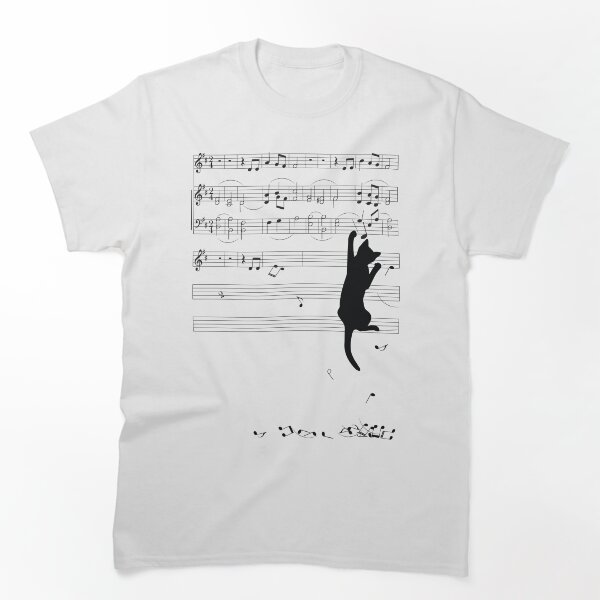

# DLS-RB-041 — Mischief Classic T-Shirt

Status: collected front-design reference; back unverified. No recipe-family synthesis.

- Product: https://www.redbubble.com/i/t-shirt/Mischief-by-TinkM/22378978/lrcw
- Marketplace: Redbubble; creator: TinkM.
- Route: https://www.redbubble.com/shop?gender=gender-men&iaCode=u-tees&sortOrder=top%20selling&includeMatureContent=true; page1, product-card position48; men. Best Selling selected;2026-10-20.
- Evidence: marketplace ordering, not audited sales/ranking window or causal proof. Founder-approved extension of4 references,2026-10-20.
- Source image: https://ih1.redbubble.net/image.233508402.8978/ssrco,classic_tee,flatlay_01,fafafa:ca443f4786,front,product_square,x600.1u2.jpg
- SHA-256: `a91af38dfb033ded21d53c99652170f35e4563d052d7d93be4e914553058579a`. Retained unedited displayed mockup; not physical sample.
- Eligibility: complete adult tee front design; no identified licensed character/celebrity. Back unverified. Actual fiber/print process, precise print size and wearer demographics unknown.
- Deduplication: additional distinct artwork after matching existing records across both gender routes. Global cross-source reconciliation still pending.

## Visual observation

White regular crew-neck flat mockup. Large sparse black musical-staff rectangle at upper center, black cat climbing down its right side and loose notes scattered below. Fine staff lines contrast solid cat silhouette; no wording. Vertical action links upper music block to tiny lower debris; broad garment white remains visible.

## Limits

Approximate proportions from mockup. Garment cut/color are observed, not verified physical specifications. No exact font ID, family classification or willingness-to-buy inference. Template/subject similarity alone is not proof of a shared recipe.
