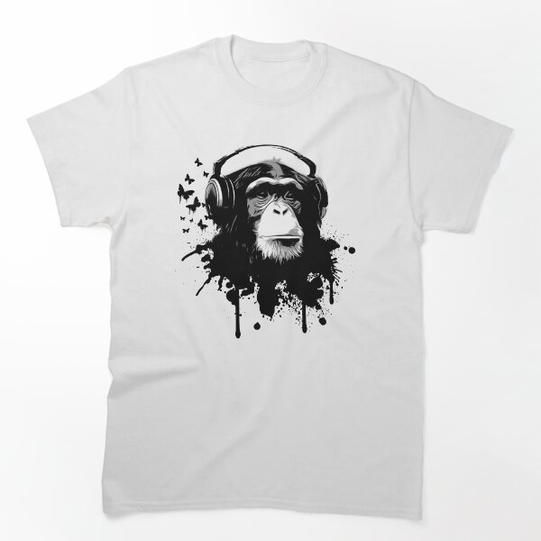

# DLS-RB-042 — Monkey Business Classic T-Shirt

Status: collected front-design reference; back unverified. No recipe-family synthesis.

- Product: https://www.redbubble.com/i/t-shirt/Monkey-Business-by-Nicklas81/9170862/lrcw
- Marketplace: Redbubble; creator: Nicklas81.
- Route: https://www.redbubble.com/shop?gender=gender-men&iaCode=u-tees&sortOrder=top%20selling&includeMatureContent=true; page1, product-card position49; men. Best Selling selected;2026-10-20.
- Evidence: marketplace ordering, not audited sales/ranking window or causal proof. Founder-approved extension of4 references,2026-10-20.
- Source image: https://ih1.redbubble.net/image.93386443.0862/ssrco,classic_tee,flatlay_01,fafafa:ca443f4786,front,product_square,x600.1u1.jpg
- SHA-256: `4689fa3b8a2519589a524b18ae75d2ac13b3962f935866736035fcd75d4e9717`. Retained unedited displayed mockup; not physical sample.
- Eligibility: complete adult tee front design; no identified licensed character/celebrity. Back unverified. Actual fiber/print process, precise print size and wearer demographics unknown.
- Deduplication: additional distinct artwork after matching existing records across both gender routes. Global cross-source reconciliation still pending.

## Visual observation

White crew-neck flat mockup. Medium centered black-and-white chimp portrait wearing headphones; rough paint splatters and dripping lower edge, small butterfly-like silhouettes at left. No copy or frame. Dense dark head contrasts white garment; expressive stencil-like portrait with irregular edge.

## Limits

Approximate proportions from mockup. Garment cut/color are observed, not verified physical specifications. No exact font ID, family classification or willingness-to-buy inference. Template/subject similarity alone is not proof of a shared recipe.
