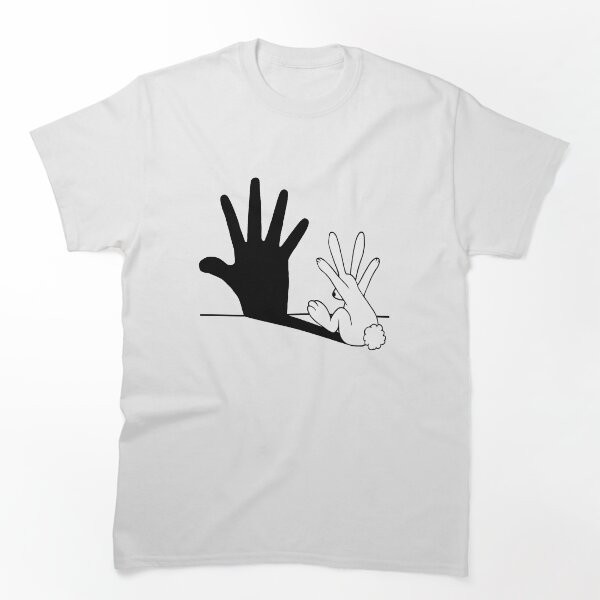

# DLS-RB-043 — Rabbit Hand Shadow Classic T-Shirt

Status: collected front-design reference; back unverified. No recipe-family synthesis.

- Product: https://www.redbubble.com/i/t-shirt/Rabbit-Hand-Shadow-by-mobiiart/13552613/lrcw.XYZ
- Marketplace: Redbubble; creator: mobiiart.
- Route: https://www.redbubble.com/shop?gender=gender-women&iaCode=u-tees&sortOrder=top%20selling&includeMatureContent=true; page1, product-card position55; women. Best Selling selected;2026-10-20.
- Evidence: marketplace ordering, not audited sales/ranking window or causal proof. Founder-approved extension of4 references,2026-10-20.
- Source image: https://ih1.redbubble.net/image.309460542.2613/ssrco,classic_tee,flatlay_01,fafafa:ca443f4786,front,product_square,x600.1u3.jpg
- SHA-256: `f102b7aee25ad33d666aff39fb817e34ec65b599bcdae5eec9bab85be7a707d8`. Retained unedited displayed mockup; not physical sample.
- Eligibility: complete adult tee front design; no identified licensed character/celebrity. Back unverified. Actual fiber/print process, precise print size and wearer demographics unknown.
- Deduplication: additional distinct artwork after matching existing records across both gender routes. Global cross-source reconciliation still pending.

## Visual observation

White crew-neck close flat mockup. Medium black silhouette of upright human hand on left, outlined rabbit at right making the shadow; thin sloping ground/shadow baseline joins them. Single-color conceptual illustration, no wording or border. Solid/outline contrast and large white voids make reversal visible.

## Limits

Approximate proportions from mockup. Garment cut/color are observed, not verified physical specifications. No exact font ID, family classification or willingness-to-buy inference. Template/subject similarity alone is not proof of a shared recipe.
