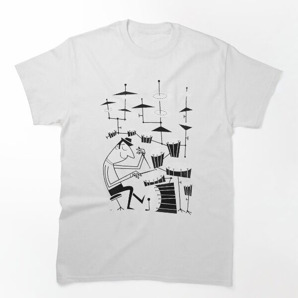

# DLS-RB-044 — Play that beat Classic T-Shirt

Status: collected front-design reference; back unverified. No recipe-family synthesis.

- Product: https://www.redbubble.com/i/t-shirt/Play-that-beat-by-tonyneal/23718392/lrcw.XYZ
- Marketplace: Redbubble; creator: tonyneal.
- Route: https://www.redbubble.com/shop?gender=gender-women&iaCode=u-tees&sortOrder=top%20selling&includeMatureContent=true; page1, product-card position57; women. Best Selling selected;2026-10-20.
- Evidence: marketplace ordering, not audited sales/ranking window or causal proof. Founder-approved extension of4 references,2026-10-20.
- Source image: https://ih1.redbubble.net/image.275972864.8392/ssrco,classic_tee,flatlay_01,fafafa:ca443f4786,front,product_square,x600.1u1.jpg
- SHA-256: `a6fc07f0f63d4d749e3088ee8d6b8a68c57511e3cfd7f08eed6641e55f4d6401`. Retained unedited displayed mockup; not physical sample.
- Eligibility: complete adult tee front design; no identified licensed character/celebrity. Back unverified. Actual fiber/print process, precise print size and wearer demographics unknown.
- Deduplication: additional distinct artwork after matching existing records across both gender routes. Global cross-source reconciliation still pending.

## Visual observation

White crew-neck close flat mockup. Tall black angular cartoon drummer amid exaggerated tiers of cymbals and drums; thin geometric lines and small solid shapes. No copy or enclosing frame. Print uses narrow vertical rhythm with open white gaps; instruments extend higher than seated figure.

## Limits

Approximate proportions from mockup. Garment cut/color are observed, not verified physical specifications. No exact font ID, family classification or willingness-to-buy inference. Template/subject similarity alone is not proof of a shared recipe.
