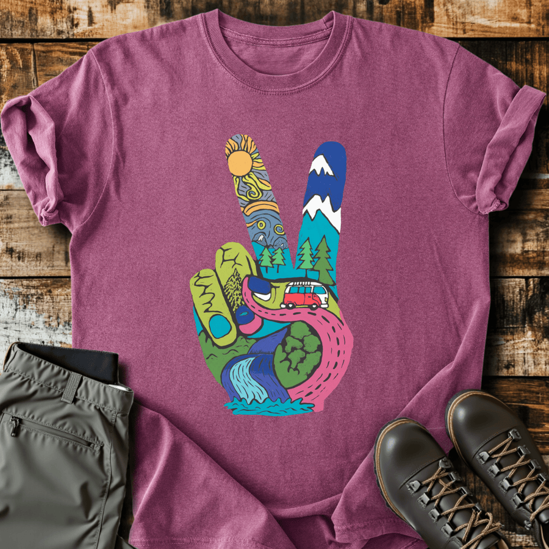

# DLS-SLOTH-002 — Funky Peace T-shirt

Status: collected front-design reference; back placement unverified. No recipe classification.

- Product: https://slothhikingclub.com/products/funky-peace-t-shirt
- Seller: Sloth Hiking Club; individual designer unknown.
- Route: https://slothhikingclub.com/collections/frontpage — default order, observed 2026-10-20, position 9, displayed page 1. Compact feed roster retained; displayed first-page order checked.
- Commercial signal: seller-designated Current Best Sellers collection membership, not audited sales or sales rank.
- Source image: https://cdn.shopify.com/s/files/1/0681/7359/4823/files/62_6005846e-008c-4dd2-a48b-2349862954fd.png?v=1737646091
- Retained SHA-256: `240545d4902823c85314392f8644a45b4cb340a4c2fde46a1787f7c6719dcb96`. Prior repository reference reused.
- Eligibility: adult physical tee; complete predefined design. Generic nature/animal subjects; no identified entertainment celebrity or licensed fictional character dependency. Bigfoot is treated as a generic folkloric creature.
- Placement: visible front graphic; no back-print evidence in product image metadata or description. No affirmative blank-back evidence established, so back remains unverified. Production suitability is separate.
- Seller-listed garment: Comfort Colors 1717, relaxed fit, garment dyed, preshrunk, 100% ring-spun cotton, 6.1 oz/yd². Actual print dimensions and physical fit unverified. Styled flat-lay props are not garment features.
- Deduplication: existing DLS-SLOTH-002 carried forward; recolors count once. No duplicate artwork found within this source batch; global reconciliation pending.

## Visual observation

Carry forward DLS-SLOTH-002 and its existing image/analysis in ../../discovery-28/SLOTH.md. Saturated landscape scenes fill a dark-outlined peace-hand silhouette on berry. The external symbol reads before the small inner scenes; no dominant text. This remains an individual observation, not a family assignment.

## Limits

Apparent proportions are qualitative estimates from a mockup. Subject affinity and outdoor identity can contribute to appeal. No causal claim about the design, audience demographics, or recipe transfer is made.
