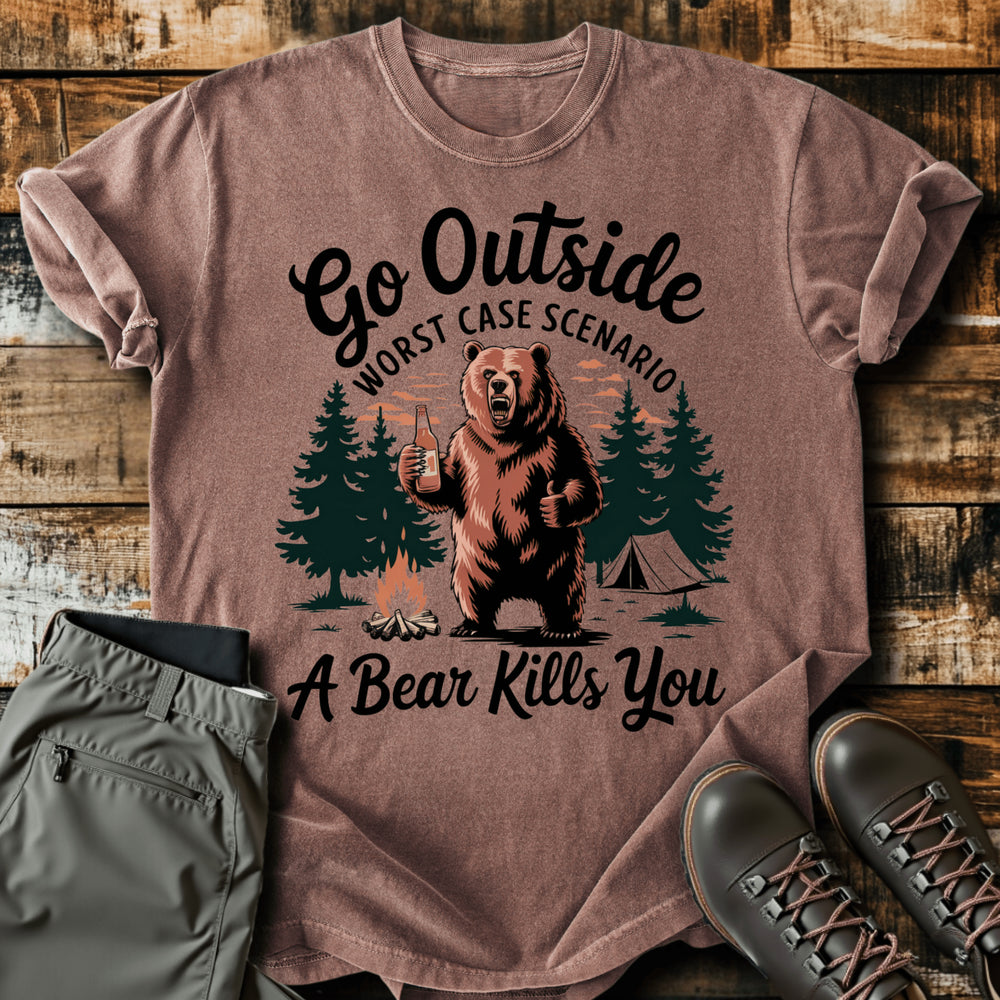

# DLS-SLOTH-005 — Go Outside  T-shirt

Status: collected front-design reference; back placement unverified. No recipe classification.

- Product: https://slothhikingclub.com/products/go-outside-t-shirt
- Seller: Sloth Hiking Club; individual designer unknown.
- Route: https://slothhikingclub.com/collections/frontpage — default order, observed 2026-10-20, position 2, displayed page 1. Compact feed roster retained; displayed first-page order checked.
- Commercial signal: seller-designated Bestsellers collection (default Featured order) membership, not audited sales or sales rank.
- Source image: https://cdn.shopify.com/s/files/1/0681/7359/4823/files/70_71e044b2-0522-4f0d-950e-928582d52edf.png?v=1737646782
- Retained SHA-256: `8f7a87b1dce694e089688a673b0c59fb47195f27b52b4a83e4be6dce1c091eaa`. Seller CDN rendition requested at width 1000 and format=jpg; source content unchanged, JPEG compression applied by CDN.
- Eligibility: adult physical tee; complete predefined design. Generic nature/animal subjects; no identified entertainment celebrity or licensed fictional character dependency. Bigfoot is treated as a generic folkloric creature.
- Placement: visible front graphic; no back-print evidence in product image metadata or description. No affirmative blank-back evidence established, so back remains unverified. Production suitability is separate.
- Seller-listed garment: Comfort Colors 1717, relaxed fit, garment dyed, preshrunk, 100% ring-spun cotton, 6.1 oz/yd². Actual print dimensions and physical fit unverified. Styled flat-lay props are not garment features.
- Deduplication: new expanded record; recolors count once. No duplicate artwork found within this source batch; global reconciliation pending.

## Visual observation

Large flowing black script arches over a bear campsite scene; a smaller curved uppercase line bridges the script and illustration. Dark green pines, warm terracotta bear and fire, and a tent form a wide middle mass, with black script payoff below. Large center-front print on muted brown garment-dyed-looking fabric. Black shades merge with bear detail; script establishes a playful informal tone. Rolled sleeves, shoes and shorts belong to mockup styling, not the printed design.

## Limits

Apparent proportions are qualitative estimates from a mockup. Subject affinity and outdoor identity can contribute to appeal. No causal claim about the design, audience demographics, or recipe transfer is made.
