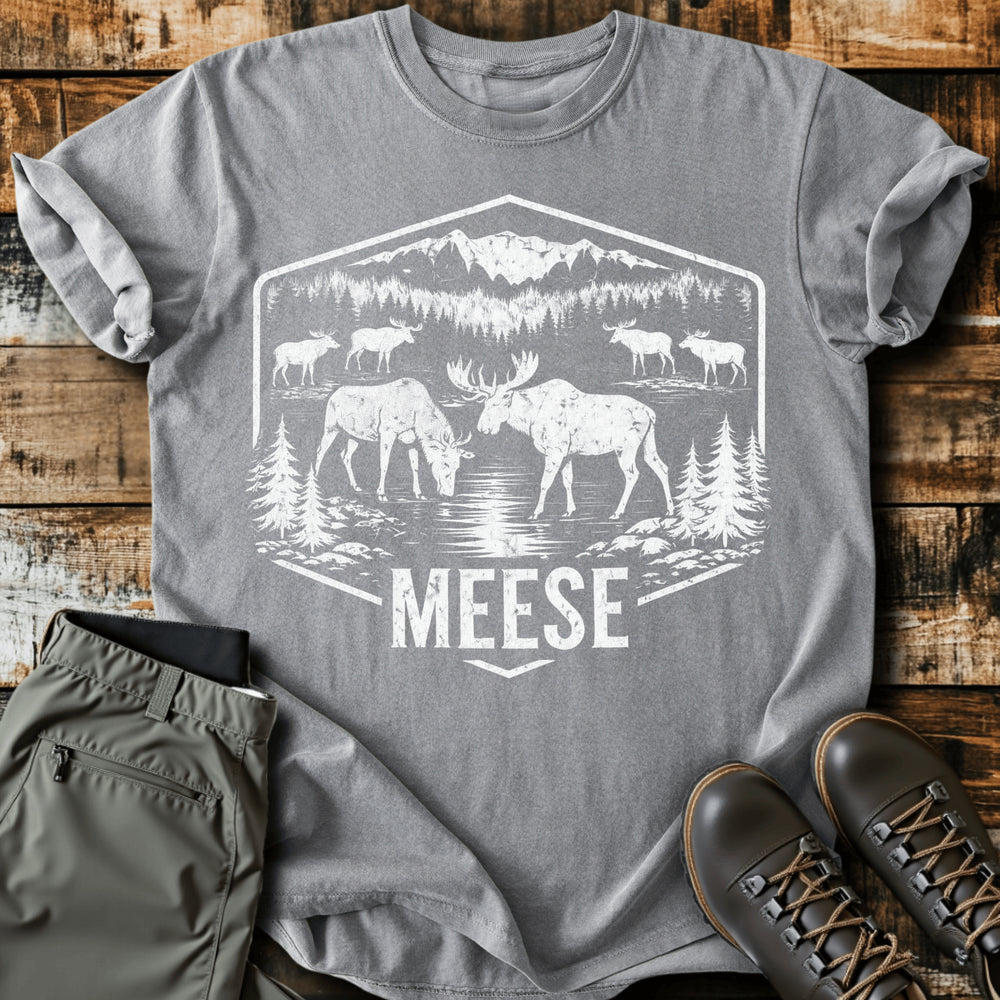

# DLS-SLOTH-006 — Meese T-shirt

Status: collected front-design reference; back placement unverified. No recipe classification.

- Product: https://slothhikingclub.com/products/meese-t-shirt
- Seller: Sloth Hiking Club; individual designer unknown.
- Route: https://slothhikingclub.com/collections/frontpage — default order, observed 2026-10-20, position 3, displayed page 1. Compact feed roster retained; displayed first-page order checked.
- Commercial signal: seller-designated Current Best Sellers collection membership, not audited sales or sales rank.
- Source image: https://cdn.shopify.com/s/files/1/0681/7359/4823/files/20260212183434-1f108417-a9b7-695c-9292-badec670cecd.png?v=1770928073
- Retained SHA-256: `6a03d7f953113423570b449184e28db38e9da4e640bd34e9c65b5368c1232404`. Seller CDN rendition requested at width 1000 and format=jpg; source content unchanged, JPEG compression applied by CDN.
- Eligibility: adult physical tee; complete predefined design. Generic nature/animal subjects; no identified entertainment celebrity or licensed fictional character dependency. Bigfoot is treated as a generic folkloric creature.
- Placement: visible front graphic; no back-print evidence in product image metadata or description. No affirmative blank-back evidence established, so back remains unverified. Production suitability is separate.
- Seller-listed garment: Comfort Colors 1717, relaxed fit, garment dyed, preshrunk, 100% ring-spun cotton, 6.1 oz/yd². Actual print dimensions and physical fit unverified. Styled flat-lay props are not garment features.
- Deduplication: new expanded record; recolors count once. No duplicate artwork found within this source batch; global reconciliation pending.

## Visual observation

White distressed moose, mountain and forest illustration sits inside an angular six-sided badge, with a bold condensed word interrupting the lower edge. The scene is approximately symmetric with two larger foreground animals and smaller background silhouettes. Large center-front on gray, single light-ink appearance; gray cloth supplies shadows and water gaps. Fine trees and weathering create texture but may reduce distance detail.

## Limits

Apparent proportions are qualitative estimates from a mockup. Subject affinity and outdoor identity can contribute to appeal. No causal claim about the design, audience demographics, or recipe transfer is made.
