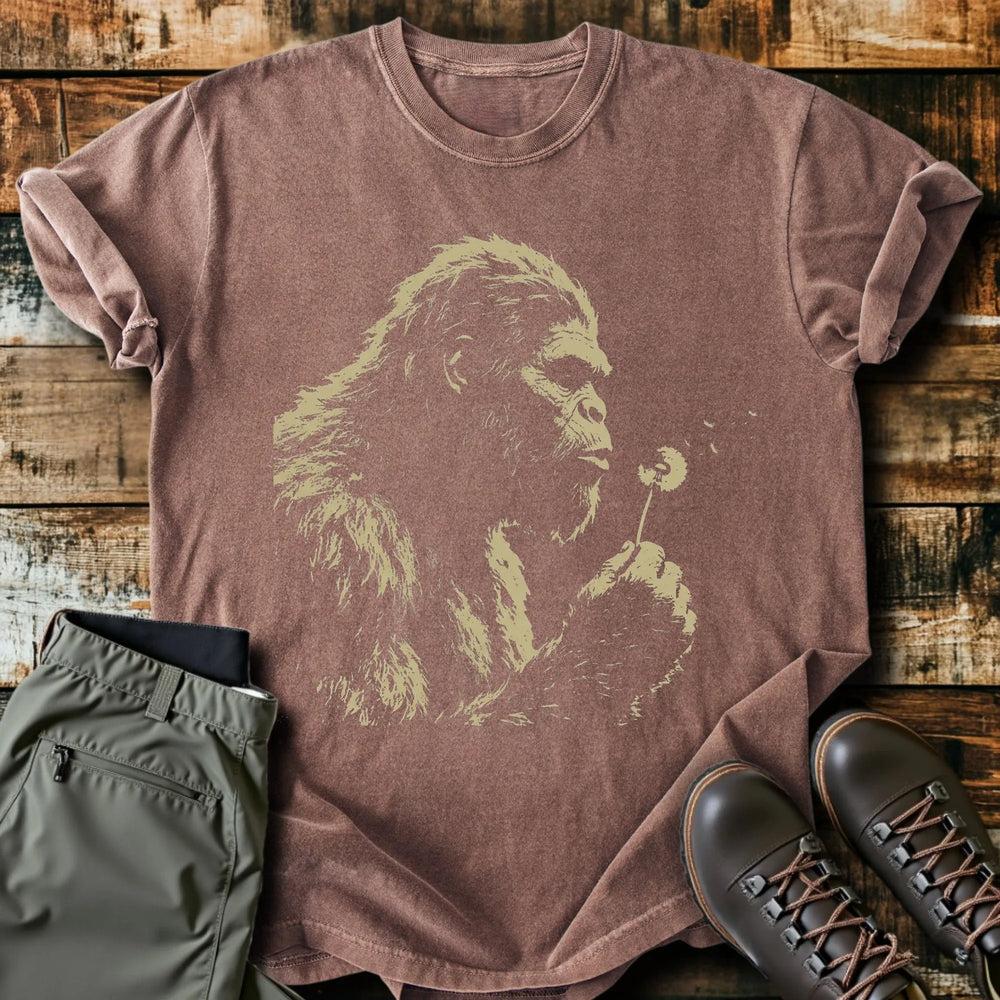

# DLS-SLOTH-007 — Blowing Wishes T-Shirt

Status: collected front-design reference; back placement unverified. No recipe classification.

- Product: https://slothhikingclub.com/products/blowing-wishes-t-shirt
- Seller: Sloth Hiking Club; individual designer unknown.
- Route: https://slothhikingclub.com/collections/frontpage — default order, observed 2026-10-20, position 4, displayed page 1. Compact feed roster retained; displayed first-page order checked.
- Commercial signal: seller-designated Current Best Sellers collection membership, not audited sales or sales rank.
- Source image: https://cdn.shopify.com/s/files/1/0681/7359/4823/files/6ad1df3c-eb50-4d5e-9b8d-1372ba706f1f_f4fb69b3-50f7-47cf-866c-bd081e5da382.webp?v=1775522078
- Retained SHA-256: `59d436db70e2eed50a3e3ea65a15e3a9607e86b4f400dc35d1bd48750d329021`. Seller CDN rendition requested at width 1000 and format=jpg; source content unchanged, JPEG compression applied by CDN.
- Eligibility: adult physical tee; complete predefined design. Generic nature/animal subjects; no identified entertainment celebrity or licensed fictional character dependency. Bigfoot is treated as a generic folkloric creature.
- Placement: visible front graphic; no back-print evidence in product image metadata or description. No affirmative blank-back evidence established, so back remains unverified. Production suitability is separate.
- Seller-listed garment: Comfort Colors 1717, relaxed fit, garment dyed, preshrunk, 100% ring-spun cotton, 6.1 oz/yd². Actual print dimensions and physical fit unverified. Styled flat-lay props are not garment features.
- Deduplication: new expanded record; recolors count once. No duplicate artwork found within this source batch; global reconciliation pending.

## Visual observation

A pale tan Bigfoot profile holds a dandelion, with a few seeds drifting into empty space to the right. Rough broken strokes describe fur and face without a surrounding outline or frame. No text. Large tall center-front silhouette on muted brown; low-to-moderate tonal contrast integrates image and garment. The single action and open right-side space are visually important; tiny seeds may be hard to retain in print.

## Limits

Apparent proportions are qualitative estimates from a mockup. Subject affinity and outdoor identity can contribute to appeal. No causal claim about the design, audience demographics, or recipe transfer is made.
