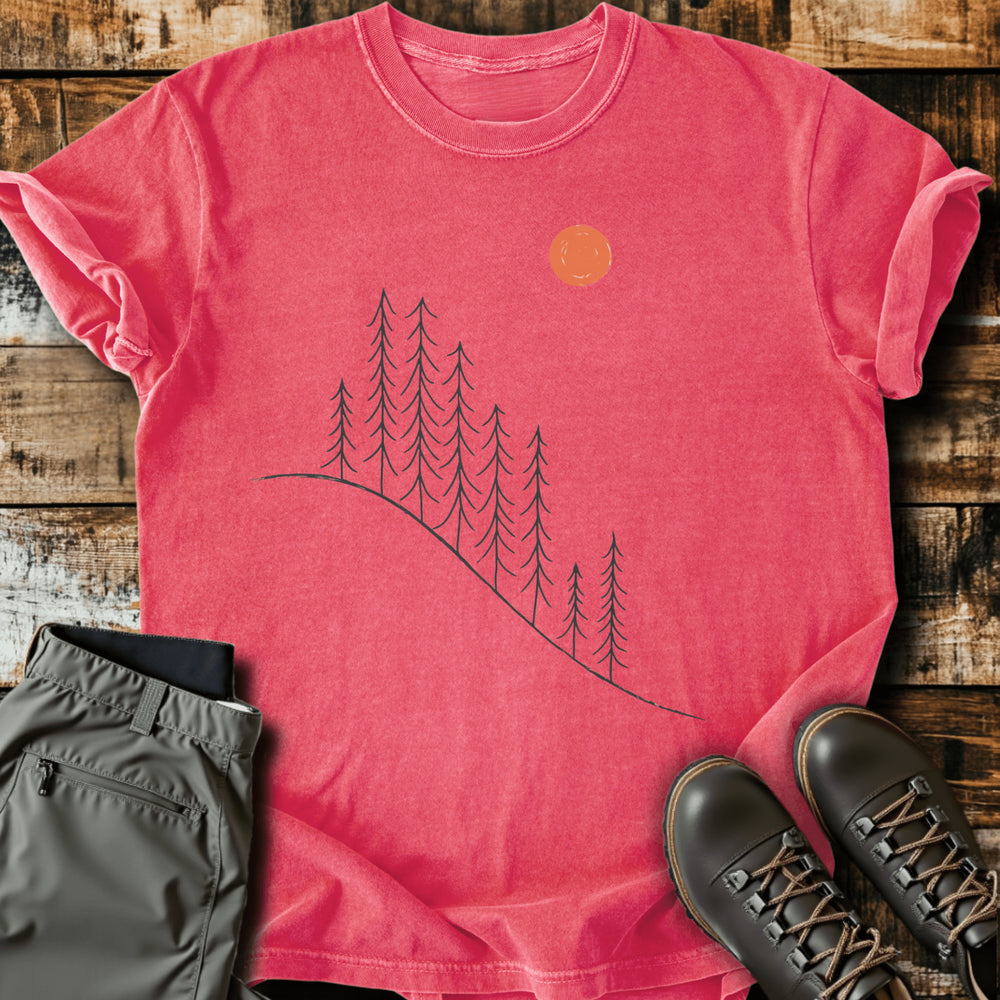

# DLS-SLOTH-008 — Sunrise Pines T-shirt

Status: collected front-design reference; back placement unverified. No recipe classification.

- Product: https://slothhikingclub.com/products/sunrise-pines-t-shirt
- Seller: Sloth Hiking Club; individual designer unknown.
- Route: https://slothhikingclub.com/collections/frontpage — default order, observed 2026-10-20, position 5, displayed page 1. Compact feed roster retained; displayed first-page order checked.
- Commercial signal: seller-designated Bestsellers collection (default Featured order) membership, not audited sales or sales rank.
- Source image: https://cdn.shopify.com/s/files/1/0681/7359/4823/files/88_b7ad3f73-fc87-44a7-b308-c848629121f8.png?v=1738651949
- Retained SHA-256: `0a9f519ba207e1417430c70eee527452fa6635dfcfc03d0f4367054e7a32e8b7`. Seller CDN rendition requested at width 1000 and format=jpg; source content unchanged, JPEG compression applied by CDN.
- Eligibility: adult physical tee; complete predefined design. Generic nature/animal subjects; no identified entertainment celebrity or licensed fictional character dependency. Bigfoot is treated as a generic folkloric creature.
- Placement: visible front graphic; no back-print evidence in product image metadata or description. No affirmative blank-back evidence established, so back remains unverified. Production suitability is separate.
- Seller-listed garment: Comfort Colors 1717, relaxed fit, garment dyed, preshrunk, 100% ring-spun cotton, 6.1 oz/yd². Actual print dimensions and physical fit unverified. Styled flat-lay props are not garment features.
- Deduplication: new expanded record; recolors count once. No duplicate artwork found within this source batch; global reconciliation pending.

## Visual observation

Thin dark hand-drawn pine trees follow one sweeping downhill curve, with a small warm orange sun isolated high to the right. No copy, border or background fill. Large diagonal center-front composition on saturated coral; extensive bare fabric between sparse strokes makes the garment color dominant. The orange/coral relationship is low contrast, while dark tree lines provide structure. Fine lines need actual print-size verification.

## Limits

Apparent proportions are qualitative estimates from a mockup. Subject affinity and outdoor identity can contribute to appeal. No causal claim about the design, audience demographics, or recipe transfer is made.
