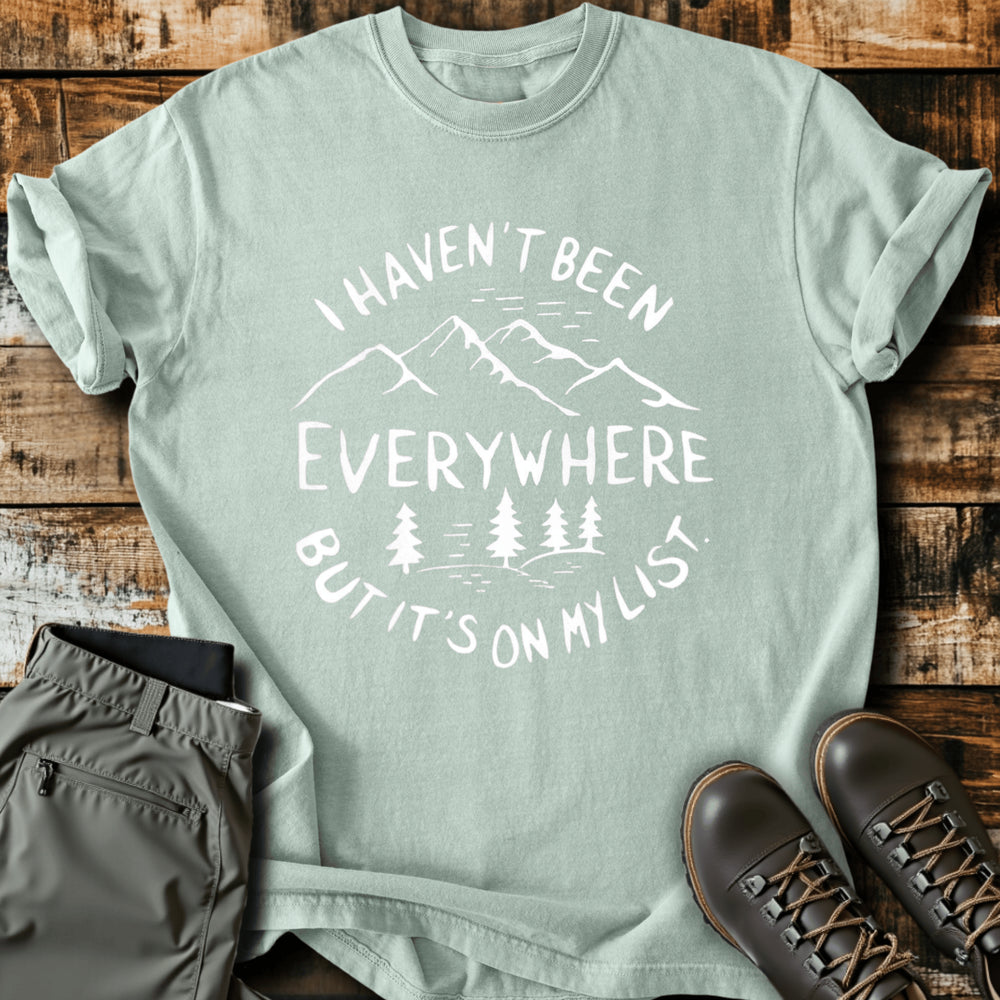

# DLS-SLOTH-009 — Haven't Been Everywhere T-shirt

Status: collected front-design reference; back placement unverified. No recipe classification.

- Product: https://slothhikingclub.com/products/havent-been-everywhere-t-shirt
- Seller: Sloth Hiking Club; individual designer unknown.
- Route: https://slothhikingclub.com/collections/frontpage — default order, observed 2026-10-20, position 6, displayed page 1. Compact feed roster retained; displayed first-page order checked.
- Commercial signal: seller-designated Current Best Sellers collection membership, not audited sales or sales rank.
- Source image: https://cdn.shopify.com/s/files/1/0681/7359/4823/files/shc_bay_ed6f94e0-da62-4edf-9108-bfbfba22e4cf.png?v=1787933658
- Retained SHA-256: `58db43d88c09cc72038a1daa4a988fe3004c3b7fe6d69575f800788271d94d42`. Seller CDN rendition requested at width 1000 and format=jpg; source content unchanged, JPEG compression applied by CDN.
- Eligibility: adult physical tee; complete predefined design. Generic nature/animal subjects; no identified entertainment celebrity or licensed fictional character dependency. Bigfoot is treated as a generic folkloric creature.
- Placement: visible front graphic; no back-print evidence in product image metadata or description. No affirmative blank-back evidence established, so back remains unverified. Production suitability is separate.
- Seller-listed garment: Comfort Colors 1717, relaxed fit, garment dyed, preshrunk, 100% ring-spun cotton, 6.1 oz/yd². Actual print dimensions and physical fit unverified. Styled flat-lay props are not garment features.
- Deduplication: new expanded record; recolors count once. No duplicate artwork found within this source batch; global reconciliation pending.

## Visual observation

White irregular hand-lettered capitals curve above and below a spare mountain-and-pine scene, with one much larger horizontal word splitting the middle. A few short lines imply sky/water. Broad circular overall silhouette on pale sage, with no drawn circle. Large front print and low contrast between white and pastel fabric. Open strokes and generous gaps make the garment color integral to the image.

## Limits

Apparent proportions are qualitative estimates from a mockup. Subject affinity and outdoor identity can contribute to appeal. No causal claim about the design, audience demographics, or recipe transfer is made.
