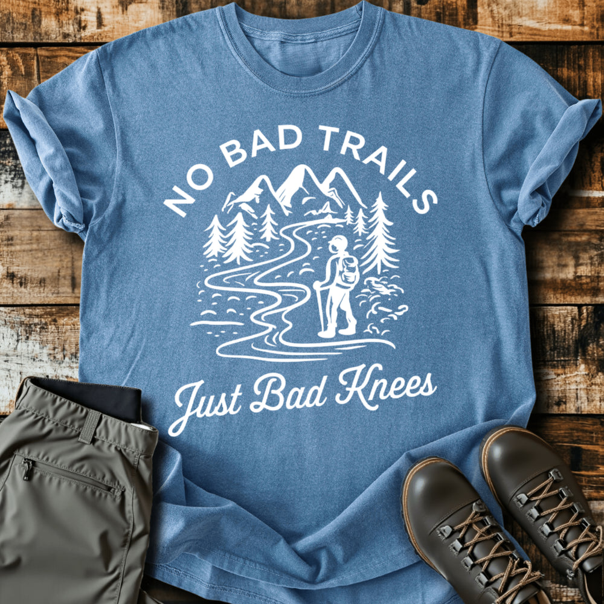

# DLS-SLOTH-010 — Bad Knees T-shirt

Status: collected front-design reference; back placement unverified. No recipe classification.

- Product: https://slothhikingclub.com/products/bad-knees-t-shirt
- Seller: Sloth Hiking Club; individual designer unknown.
- Route: https://slothhikingclub.com/collections/frontpage — default order, observed 2026-10-20, position 7, displayed page 1. Compact feed roster retained; displayed first-page order checked.
- Commercial signal: seller-designated Bestsellers collection (default Featured order) membership, not audited sales or sales rank.
- Source image: https://cdn.shopify.com/s/files/1/0681/7359/4823/files/13_a6915790-4910-4611-a0ab-4ec3dc1438fa.png?v=1737642566
- Retained SHA-256: `1fc64e2999f76fa15c0a52990e0e6f264f10acc3525b8fec48b33c80c7ec3020`. Seller CDN rendition requested at width 1000 and format=jpg; source content unchanged, JPEG compression applied by CDN.
- Eligibility: adult physical tee; complete predefined design. Generic nature/animal subjects; no identified entertainment celebrity or licensed fictional character dependency. Bigfoot is treated as a generic folkloric creature.
- Placement: visible front graphic; no back-print evidence in product image metadata or description. No affirmative blank-back evidence established, so back remains unverified. Production suitability is separate.
- Seller-listed garment: Comfort Colors 1717, relaxed fit, garment dyed, preshrunk, 100% ring-spun cotton, 6.1 oz/yd². Actual print dimensions and physical fit unverified. Styled flat-lay props are not garment features.
- Deduplication: new expanded record; recolors count once. No duplicate artwork found within this source batch; global reconciliation pending.

## Visual observation

White sans-serif capitals arch above a mountain/trail scene; flowing italic script forms the lower payoff. A small hiker and curving trail provide the central action, with pine trees framing both sides. Large center-front on faded blue; white linework and filled highlights leave much of the cloth visible. Type styles separate setup and payoff, while the scene supplies the hiking connection.

## Limits

Apparent proportions are qualitative estimates from a mockup. Subject affinity and outdoor identity can contribute to appeal. No causal claim about the design, audience demographics, or recipe transfer is made.
