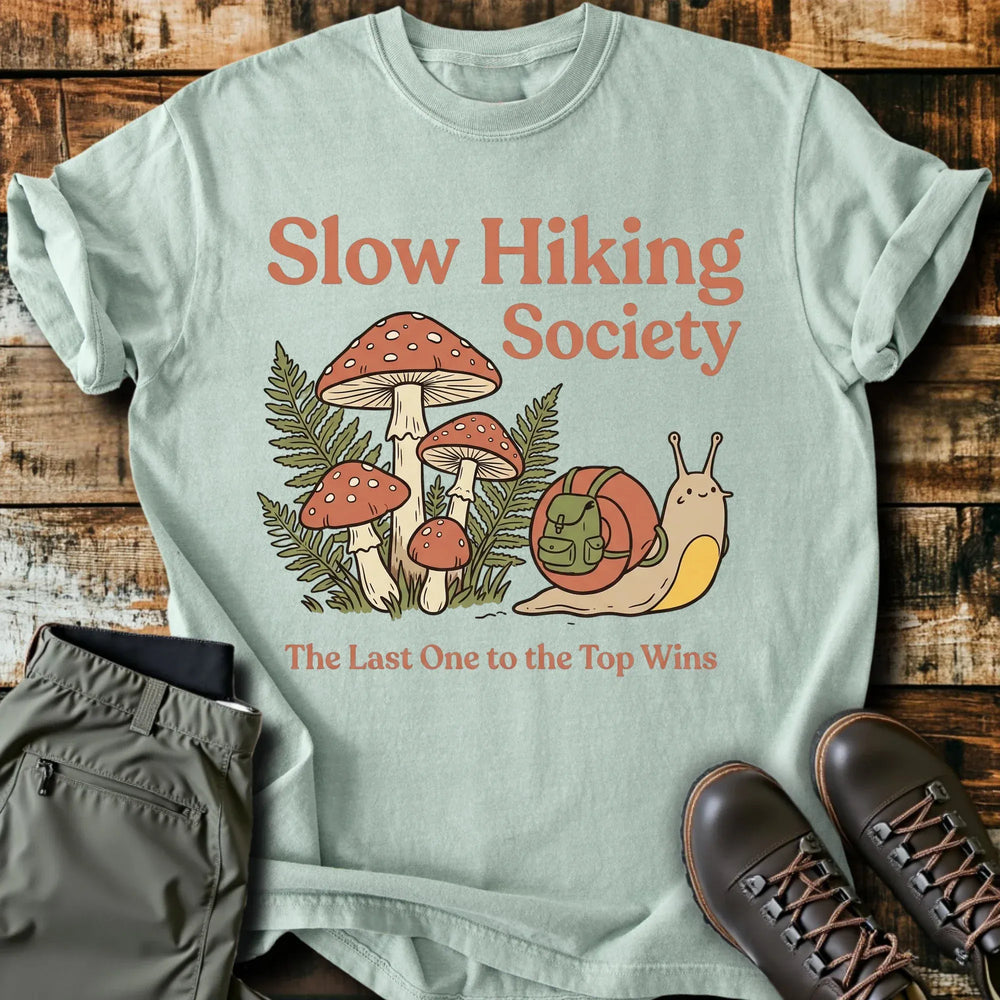

# DLS-SLOTH-013 — Slow Hiking Society Snail T-Shirt

Status: collected front-design reference; back placement unverified. No recipe classification.

- Product: https://slothhikingclub.com/products/slow-hiking-society-snail-t-shirt
- Seller: Sloth Hiking Club; individual designer unknown.
- Route: https://slothhikingclub.com/collections/frontpage — default order, observed 2026-10-20, position 11, displayed page 1. Compact feed roster retained; displayed first-page order checked.
- Commercial signal: seller-designated Bestsellers collection (default Featured order) membership, not audited sales or sales rank.
- Source image: https://cdn.shopify.com/s/files/1/0681/7359/4823/files/cf4aefe3-c530-4483-b756-a9a025396c10_dc9260a4-ad6e-4475-9712-044d67734d5e.webp?v=1773931055
- Retained SHA-256: `662be4df483078a74359d8d2505ac55e0228360bf3182a18b48018808bb6280b`. Seller CDN rendition requested at width 1000 and format=jpg; source content unchanged, JPEG compression applied by CDN.
- Eligibility: adult physical tee; complete predefined design. Generic nature/animal subjects; no identified entertainment celebrity or licensed fictional character dependency. Bigfoot is treated as a generic folkloric creature.
- Placement: visible front graphic; no back-print evidence in product image metadata or description. No affirmative blank-back evidence established, so back remains unverified. Production suitability is separate.
- Seller-listed garment: Comfort Colors 1717, relaxed fit, garment dyed, preshrunk, 100% ring-spun cotton, 6.1 oz/yd². Actual print dimensions and physical fit unverified. Styled flat-lay props are not garment features.
- Deduplication: new expanded record; recolors count once. No duplicate artwork found within this source batch; global reconciliation pending.

## Visual observation

Warm coral bold serif title occupies two offset lines above a smiling backpack-wearing snail and tall mushrooms. Cream, coral and olive flat fills are held by dark hand-drawn outlines; a smaller serif sentence anchors the bottom. Broad large center-front on pale sage, with mushroom height balancing the shorter snail. Cute character props supply hiking context; the lower sentence is much smaller than the title and image.

## Limits

Apparent proportions are qualitative estimates from a mockup. Subject affinity and outdoor identity can contribute to appeal. No causal claim about the design, audience demographics, or recipe transfer is made.
