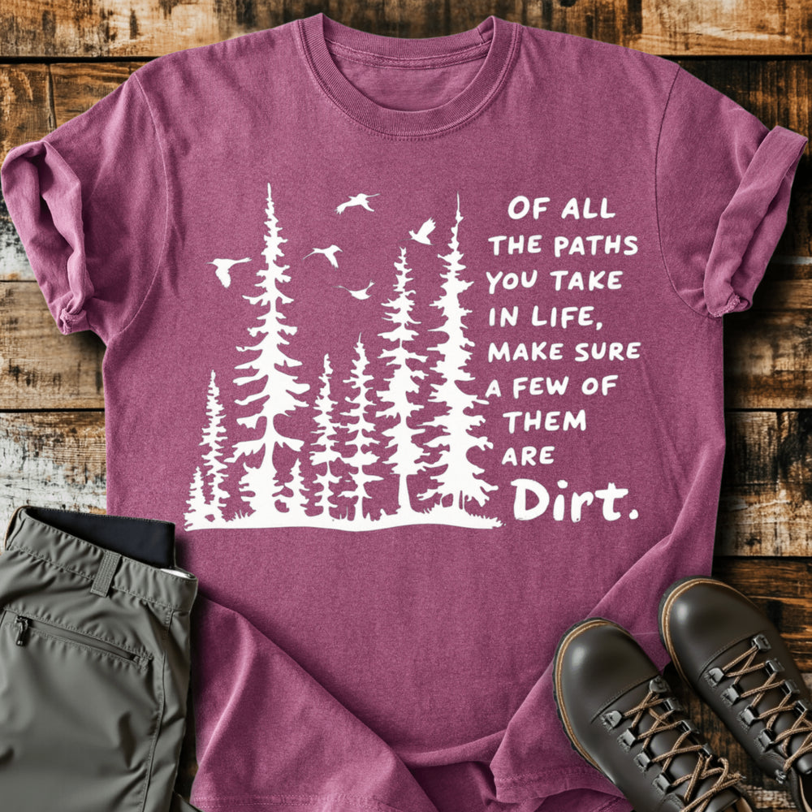

# DLS-SLOTH-015 — Paths In Life T-shirt

Status: collected front-design reference; back placement unverified. No recipe classification.

- Product: https://slothhikingclub.com/products/paths-in-life-t-shirt
- Seller: Sloth Hiking Club; individual designer unknown.
- Route: https://slothhikingclub.com/collections/frontpage — default order, observed 2026-10-20, position 13, displayed page 1. Compact feed roster retained; displayed first-page order checked.
- Commercial signal: seller-designated Bestsellers collection (default Featured order) membership, not audited sales or sales rank.
- Source image: https://cdn.shopify.com/s/files/1/0681/7359/4823/files/313_df9b1ff1-7fa9-49df-ab9e-20b9ce129b88.png?v=1738648204
- Retained SHA-256: `ecd54c3bc27d8ddaa792b7dd565f0763ead81ec6df61d87cb5ce932ad21c43f4`. Seller CDN rendition requested at width 1000 and format=jpg; source content unchanged, JPEG compression applied by CDN.
- Eligibility: adult physical tee; complete predefined design. Generic nature/animal subjects; no identified entertainment celebrity or licensed fictional character dependency. Bigfoot is treated as a generic folkloric creature.
- Placement: visible front graphic; no back-print evidence in product image metadata or description. No affirmative blank-back evidence established, so back remains unverified. Production suitability is separate.
- Seller-listed garment: Comfort Colors 1717, relaxed fit, garment dyed, preshrunk, 100% ring-spun cotton, 6.1 oz/yd². Actual print dimensions and physical fit unverified. Styled flat-lay props are not garment features.
- Deduplication: new expanded record; recolors count once. No duplicate artwork found within this source batch; global reconciliation pending.

## Visual observation

White pine silhouettes and small flying birds occupy the left portion of a broad chest block; short irregular uppercase lines form a tall column on the right. The last word is much larger. Large center-front on berry, one light-color appearance, no enclosing frame. Shared lower baseline connects illustration and copy. Long text requires close reading even though the trees communicate nature immediately.

## Limits

Apparent proportions are qualitative estimates from a mockup. Subject affinity and outdoor identity can contribute to appeal. No causal claim about the design, audience demographics, or recipe transfer is made.
