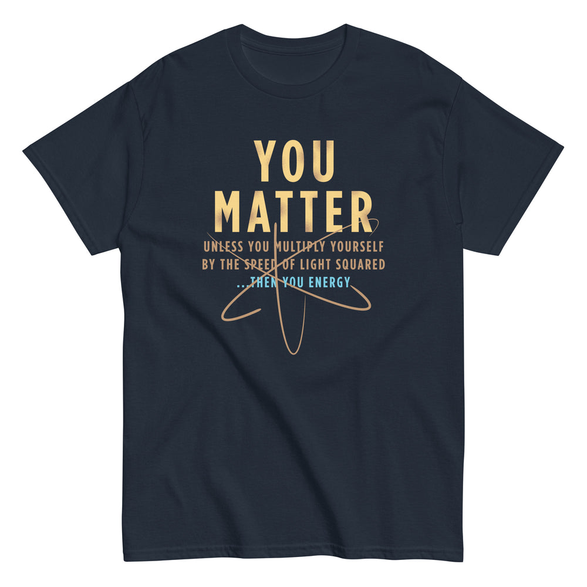

# DLS-SNORG-005 — You Matter Men's Classic Tee

Status: collected front-design reference; back placement unverified. No recipe classification.

- Product: https://www.snorgtees.com/products/you-matter-mens-classic-tee
- Seller: SnorgTees; individual designer unknown.
- Collection: https://www.snorgtees.com/collections/best-sellers
- Observed: 2026-10-20, collection default order, position 3, first displayed page. Product feed agrees with displayed order.
- Commercial signal: seller-designated bestseller collection membership, not audited sales or a sales rank.
- Source image: https://cdn.shopify.com/s/files/1/0584/1810/2404/files/mens-classic-tee-navy-front-64cd5f90c26e8.jpg?v=1691180958
- Retained rendition: seller CDN rendition at width 1000, unaltered.
- SHA-256: `8ca261625f4e8ee661658d0f758f8f9dde2eb2d2845ca2539a68fa39fc8b9a31`
- Eligibility: adult physical tee; complete predefined design; no identified licensed character or celebrity dependency. Front graphic directly inspected. Gallery metadata lists front renditions; no back image or explicit blank-back assurance was established. Do not claim verified front-only merchandise.
- Garment: seller-listed classic crewneck, solid colors cotton; heathers contain polyester, unspecified percentage. Fabric weight and actual worn print dimensions unknown. Image is a mockup, not a physical measurement.
- Deduplication: new source record; no within-batch artwork duplication identified; global deduplication pending.

## Visual observation

Gold condensed capitals form a dominant two-line block on navy. Thin orbital lines overlap the lower headline; small gold qualifiers and a cyan closing line create a steep scale hierarchy. The shirt supplies the dark background. Medium-tall centered chest print; tiny qualifying copy may disappear at viewing distance. Science subject matter and typography must be evaluated separately.

## Scope

Record visual relationships only. Apparent proportions are qualitative mockup estimates. No audience-demographic inference, sales-causality claim, or copying permission follows from collection membership.
