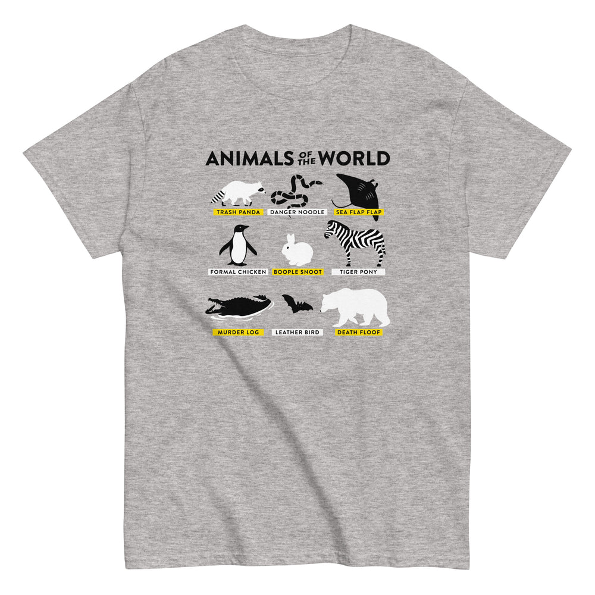

# DLS-SNORG-006 — Animals Of The World Men's Classic Tee

Status: collected front-design reference; back placement unverified. No recipe classification.

- Product: https://www.snorgtees.com/products/animals-of-the-world-mens-classic-tee
- Seller: SnorgTees; individual designer unknown.
- Collection: https://www.snorgtees.com/collections/best-sellers
- Observed: 2026-10-20, collection default order, position 5, first displayed page. Product feed agrees with displayed order.
- Commercial signal: seller-designated bestseller collection membership, not audited sales or a sales rank.
- Source image: https://cdn.shopify.com/s/files/1/0584/1810/2404/files/mens-classic-tee-sport-grey-front-64c030733ba71.jpg?v=1690317004
- Retained rendition: seller CDN rendition at width 1000, unaltered.
- SHA-256: `586f17cfccd3016bb812dc629deb4cf6d48204e2d51e4f2824f04e8a7f17f1bb`
- Eligibility: adult physical tee; complete predefined design; no identified licensed character or celebrity dependency. Front graphic directly inspected. Gallery metadata lists front renditions; no back image or explicit blank-back assurance was established. Do not claim verified front-only merchandise.
- Garment: seller-listed classic crewneck, solid colors cotton; heathers contain polyester, unspecified percentage. Fabric weight and actual worn print dimensions unknown. Image is a mockup, not a physical measurement.
- Deduplication: new source record; no within-batch artwork duplication identified; global deduplication pending.

## Visual observation

A compact black headline sits above a three-by-three animal grid on heather gray. Black-and-white animal silhouettes sit over alternating yellow/white label bars. Equal cells and repeated small capitals produce a specimen-chart rhythm, with no enclosing rectangular background. Medium centered chest block; label readability and species recognition depend on detail size.

## Scope

Record visual relationships only. Apparent proportions are qualitative mockup estimates. No audience-demographic inference, sales-causality claim, or copying permission follows from collection membership.
